# Super Cursos

Este README reúne dois exercícios do projeto Super Cursos em seções separadas. O A2 (anterior), sobre CI/CD e observabilidade, aparece primeiro; o B1 (atual), sobre arquitetura, vem depois. O código e as evidências de ambos continuam no mesmo repositório.

**Repositório:** [github.com/MuriloAras/devops-ac1](https://github.com/MuriloAras/devops-ac1)

## Como rodar a aplicação

**Requisitos:** Docker Desktop instalado e aberto. O primeiro início precisa de internet para baixar e montar os serviços. Não é necessário instalar Java ou Node para rodar a aplicação pelo Docker.

O comando abaixo inicia a homologação, um ambiente para conferir a aplicação antes de uma entrega.

Na pasta principal do projeto, rode:

```bash
docker compose -f docker-compose.homol.yml up --build -d
docker compose -f docker-compose.homol.yml ps
```

Quando os serviços estiverem prontos, acesse:

| Serviço | Endereço | Acesso inicial |
| --- | --- | --- |
| Aplicação | [http://localhost:3002](http://localhost:3002) | — |
| API | [http://localhost:8082/swagger-ui.html](http://localhost:8082/swagger-ui.html) | — |
| PgAdmin | [http://localhost:5051](http://localhost:5051) | `admin@admin.com` / `admin_local` |
| Prometheus | [http://localhost:9092](http://localhost:9092) | — |
| Grafana | [http://localhost:3003](http://localhost:3003) | `admin` / `admin_local` |

Para conectar o PgAdmin ao banco que roda no Docker, use o host `postgres`, porta `5432`, banco `supercursos_homol`, usuário `supercursos` e senha `supercursos_local`.

Para parar a aplicação, rode:

```bash
docker compose -f docker-compose.homol.yml down
```

Os dados do banco ficam salvos em um volume do Docker e continuam lá quando os serviços são parados dessa forma. Para apagar também os dados salvos, use `docker compose -f docker-compose.homol.yml down -v`. As portas e senhas podem ser alteradas em um arquivo `.env`, criado a partir de `.env.example`.

---

## EXERCÍCIO A2 — CI/CD e observabilidade (ANTERIOR)


### Exercício proposto

Aplicar práticas de CI/CD ao Super Cursos: manter a esteira em um `Jenkinsfile`, construir os containers, implantar em homologação, executar testes antes e depois da publicação e guardar evidências. O ambiente também usa Prometheus e Grafana para acompanhar os serviços.

A aplicação mantém autenticação e troca de moedas por cursos; cada curso custa 3 moedas e a aquisição é bloqueada quando o saldo é insuficiente.

### O que mudou em relação à AC1

| AC1 | A2 |
| --- | --- |
| Testes e builds executados manualmente | Esteira Jenkins com etapas e condições de falha definidas em código |
| JUnit e evidências de TDD | JUnit, integração PostgreSQL/Testcontainers e seis cenários Cypress |
| API, PostgreSQL e pgAdmin em containers; frontend em desenvolvimento | Homologação com frontend Vue/Nginx, API, banco e monitoramento |
| Validação manual após iniciar os serviços | Health checks e testes E2E depois do deploy |
| Relatórios locais de testes e cobertura | Relatórios JUnit, JaCoCo e PMD arquivados no Jenkins |
| Prints da aplicação e dos testes | Prints, vídeo, logs, relatórios e estados dos serviços organizados por execução |

### Como ocorreu a execução

O job `A2_P2_supercursos_pipeline` foi iniciado manualmente e leu o código de um repositório Git local. A sequência foi:

`Checkout → JUnit/PostgreSQL → JaCoCo/PMD → Package → Build Docker → Deploy HOMOL → Health checks → Cypress → Observabilidade`

Uma falha nos testes interrompe o avanço. O Docker Compose inicia frontend, API, PostgreSQL, pgAdmin, Prometheus e Grafana. Os seis cenários Cypress cobriram login válido e inválido, compra com saldos 3 e 5, bloqueio com saldo 2 e persistência após novo login. A publicação no Docker Hub ficou desabilitada no registro histórico.

### Resultado registrado

Jenkins **build #3: SUCCESS**, em **15/10/2026**, com duração de **2 min 11 s**, no commit registrado `1d37dcf`.

- **40 testes aprovados:** 26 de unidade, 8 de integração PostgreSQL e 6 Cypress.
- **JaCoCo:** 98,80% das linhas e 100% dos branches; **PMD:** nenhuma ocorrência.
- **Homologação:** seis serviços saudáveis e API com estado `UP`.
- **Monitoramento:** target Prometheus `UP`, consulta `up=1` no Grafana e quatro painéis.

### Evidências do A2

- [`evidencias/AC2/p2/`](evidencias/AC2/p2/): configuração e resumo do Jenkins, estágios, console, testes, JaCoCo e PMD.
- [`evidencias/AC2/p3/`](evidencias/AC2/p3/): saúde da API, containers, Prometheus, capturas e vídeo do Cypress.
- [`evidencias/AC2/grafana/`](evidencias/AC2/grafana/): dashboard, consultas e arquivos exportados.
- [`evidencias/AC1/`](evidencias/AC1/): evidências da versão anterior, como TDD, cobertura, banco, Docker e Swagger.

#### Prints do Jenkins

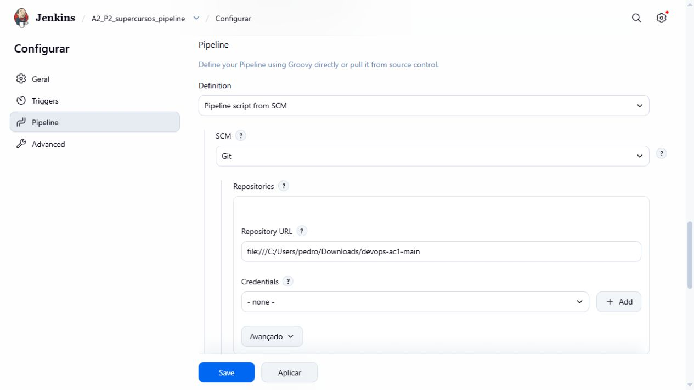

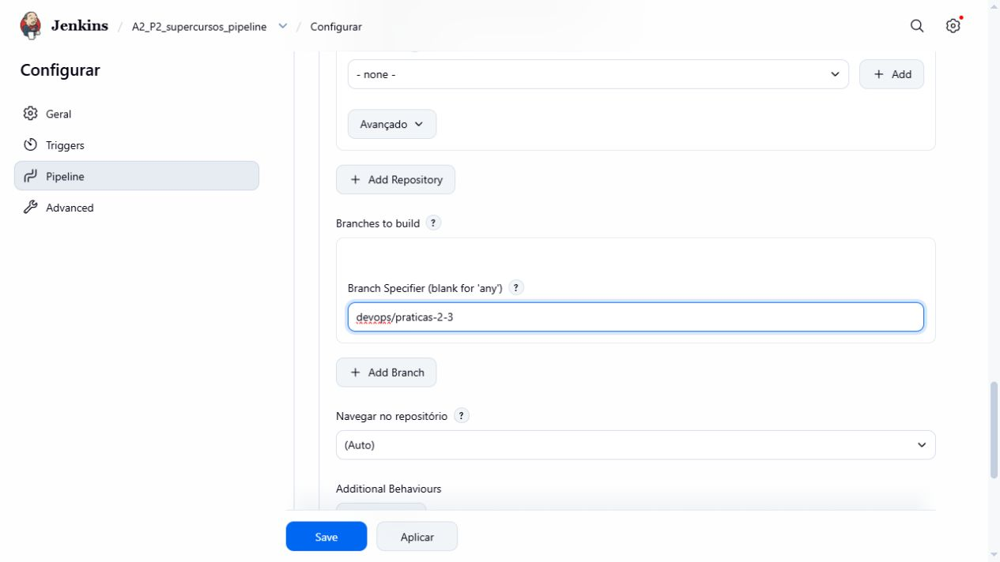

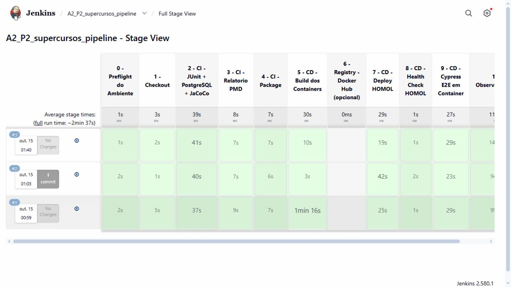

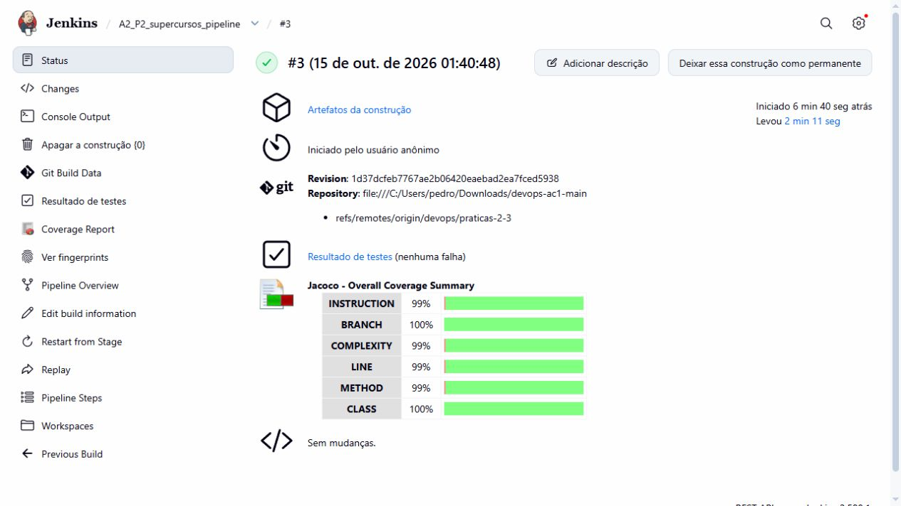

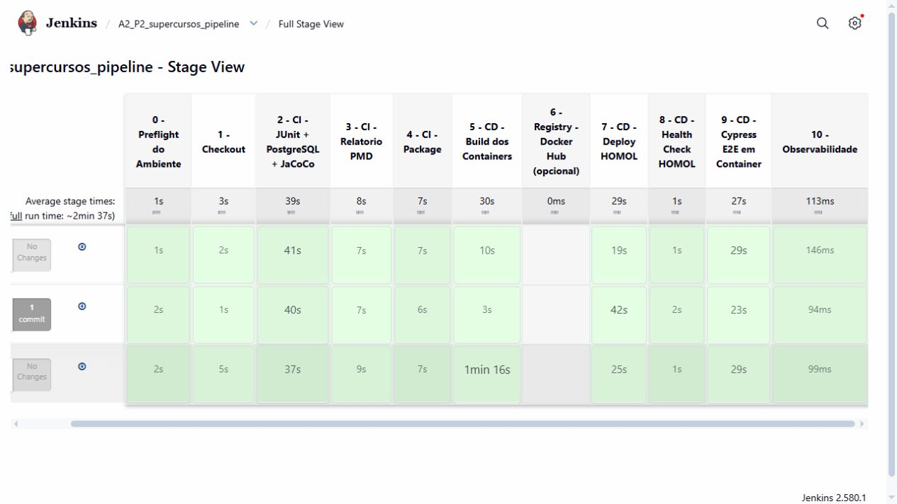

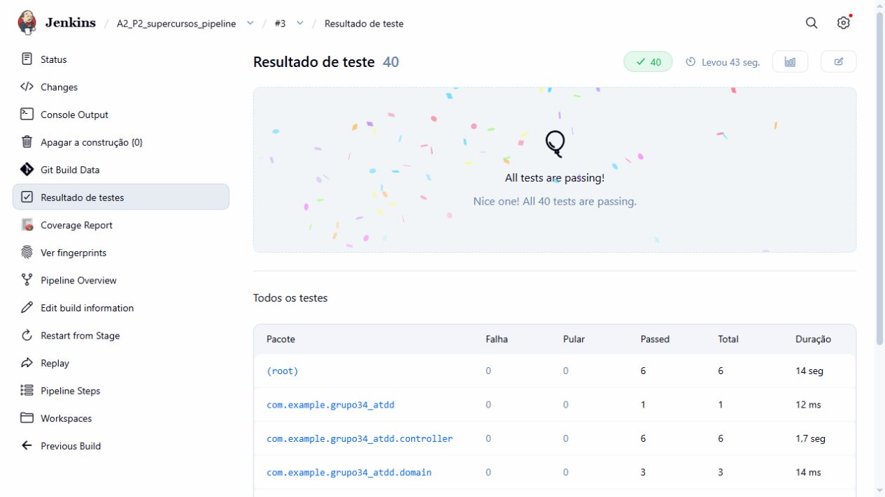

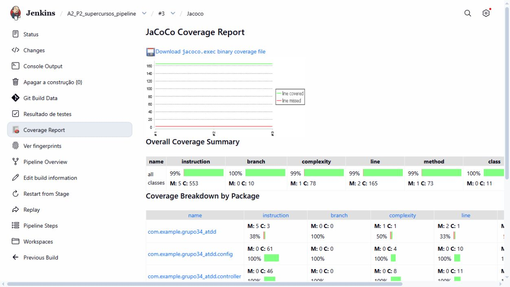

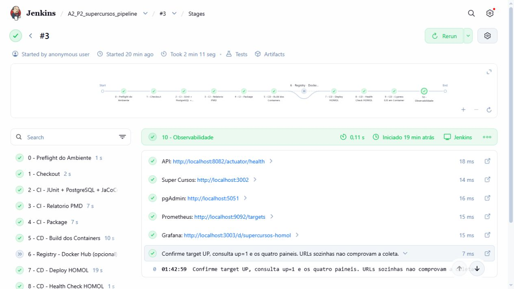

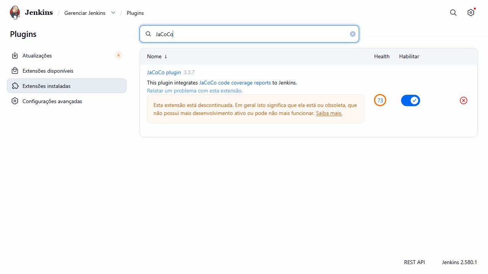

#### Prints da homologação e do monitoramento

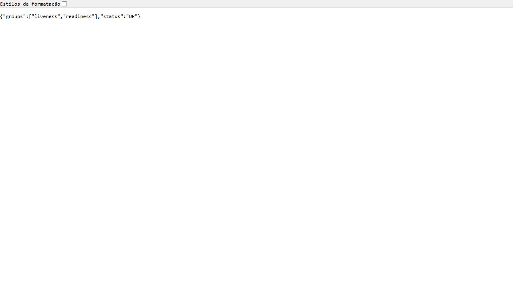

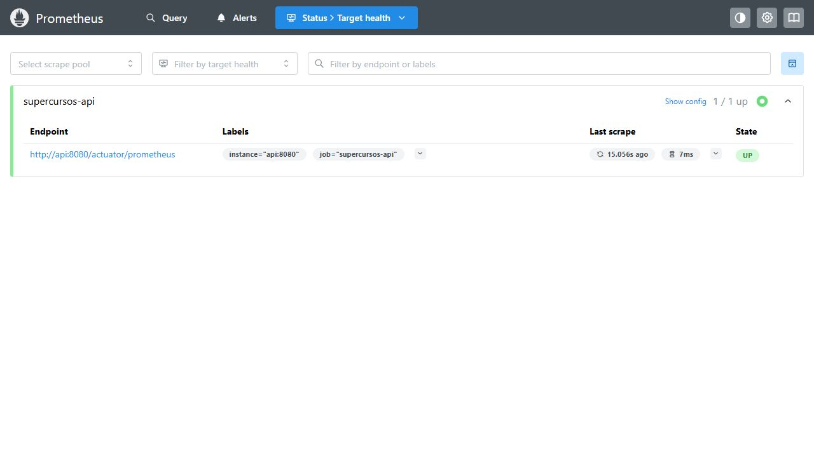

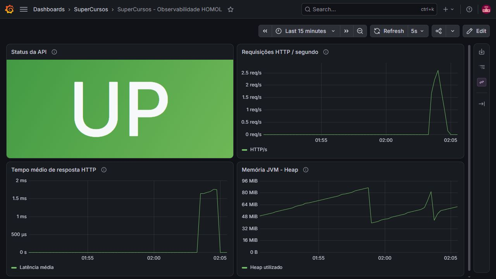

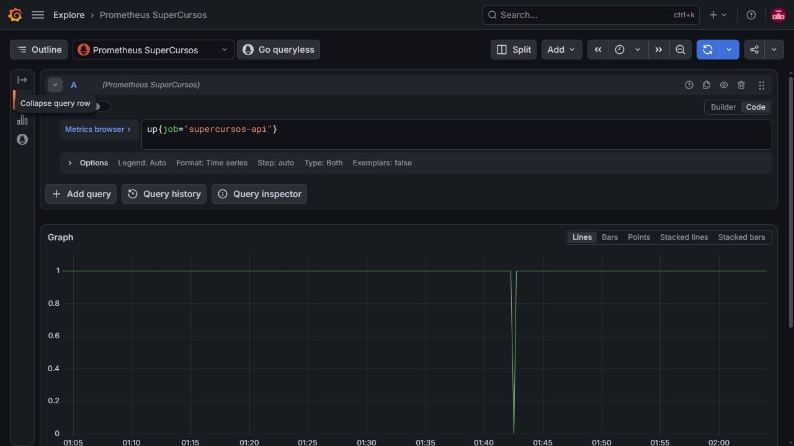

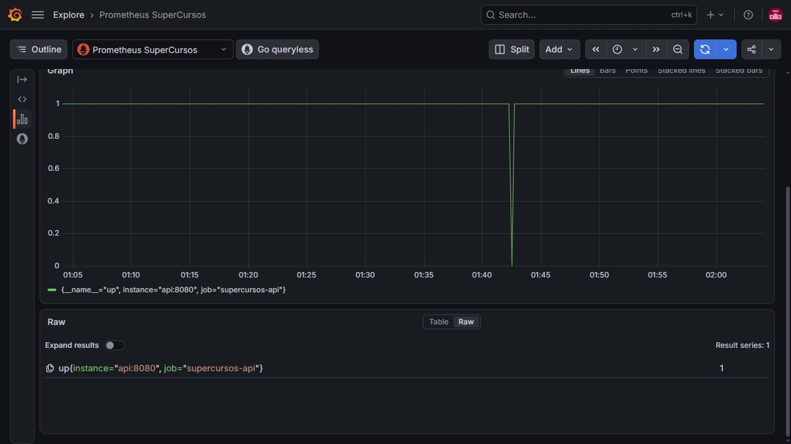

A execução detalhada e os relatórios arquivados ficam em `evidencias/AC2/p2/build-3-20261015T044637939Z` e `evidencias/AC2/p3/build-3-20261015T044637939Z`. O `manifesto-coleta.json` registra o build, o commit e os hashes dos relatórios e mídias.

### Como repetir a execução A2

O registro original foi executado pela branch `Exercicio-A2`. Requisitos: JDK 21, Git, Docker com Compose e Jenkins com acesso ao Docker. Instale os plugins Pipeline, Git, JUnit, JaCoCo, Credentials Binding, Timestamper e Stage View.

1. Inicie o Jenkins e abra `http://localhost:9090`.
2. Crie um job do tipo **Pipeline** com o nome `A2_P2_supercursos_pipeline`.
3. Em **Pipeline**, selecione **Pipeline script from SCM** e **Git**.
4. Use o repositório `https://github.com/MuriloAras/devops-ac1.git` e a branch `*/Exercicio-A2`.
5. Informe `Jenkinsfile` como caminho do script e salve.
6. Execute **Build Now**. Para execução local, mantenha `PUSH_DOCKER_HUB` desmarcado.

Acompanhe **Console Output** até `SUCCESS`; os relatórios JUnit, JaCoCo e PMD ficam no build. Os endereços de homologação são: frontend `http://localhost:3002`, API `http://localhost:8082/actuator/health`, pgAdmin `http://localhost:5051`, Prometheus `http://localhost:9092/targets` e Grafana `http://localhost:3003/d/supercursos-homol`.

Equipe registrada no A2: Murilo Araujo, Beatriz Silva e Pedro Augusto.

---

## EXERCÍCIO B1 — Arquitetura (ATUAL)

### 1. Leitura do cenário

O Super Cursos começou como um MVP e agora considera um cenário de até 100.000 usuários. O Ranking pode crescer mais que as outras funções, enquanto cursos, moedas, conquistas e recompensas também continuam evoluindo.

A pergunta principal foi: precisamos separar o sistema em vários serviços agora, ou organizar melhor o código dentro da aplicação que já existe? Como ainda não temos medições que mostrem um gargalo, escolhemos primeiro organizar o Core em módulos.

### 2. RFs afetados

| ID | Requisito funcional | Impacto no desafio |
| --- | --- | --- |
| RF01 | Ranking | Registrar pontuações e mostrar a classificação dos alunos. |
| RF02 | Conquistas e gamificação | Manter a evolução de conquistas e recompensas junto às demais funções do Core. |

### 3. RNFs e seleção dos ASRs

RNFs são qualidades esperadas do sistema. Um RNF é um ASR quando pode influenciar diretamente a organização ou a operação da aplicação. Para este desafio, selecionamos três:

| RNF | ASR? | Justificativa |
| --- | --- | --- |
| Manutenibilidade | Sim | Separar o código por funcionalidade ajuda a localizar regras e reduz o impacto de mudanças. |
| Escalabilidade | Sim, como necessidade futura | A fronteira do Ranking permite acompanhar seu crescimento e considerar uma separação se os dados mostrarem que é preciso. |
| Complexidade operacional | Sim | Uma equipe de três pessoas precisa conseguir manter e executar a solução. |
| Desempenho | Não neste momento | É importante, mas ainda não temos medições que mostrem um problema de desempenho causado pela arquitetura. |
| Testabilidade | Não como decisão macro | É importante e os testes podem ser organizados por módulo, mas não exige separar a aplicação em serviços. |

### 4. RPCs — restrições e premissas

| RPC | Consequência para a decisão |
| --- | --- |
| O Core já usa Java e Spring Boot | Aproveitar a aplicação existente e evoluir aos poucos. |
| O projeto tem uma equipe de três pessoas | Manter uma solução que a equipe consiga operar. |
| O banco relacional atual deve continuar | Não trocar o banco sem uma necessidade demonstrada. |
| A aplicação da AC1 é o ponto de partida | Preservar seu comportamento e seus contratos. |
| A previsão é de até 100.000 usuários, sem teste de carga que comprove um gargalo | Não tratar a previsão, sozinha, como motivo para criar serviços separados. |

### 5. Alternativas e trade-offs

| Alternativa | Benefícios | Custos e riscos | Avaliação |
| --- | --- | --- | --- |
| A — Monólito em camadas | É simples de executar e mantém a organização atual. | Funcionalidades diferentes continuam espalhadas pelas mesmas camadas técnicas. | Poderia continuar sendo usado, mas organiza menos claramente as funções do produto. |
| B — Monólito modular | Organiza o código por funcionalidade e mantém uma aplicação e um deploy. | Os módulos ainda compartilham o processo e o banco; não escalam separadamente. | É a opção que melhor atende às necessidades atuais. |
| C — Serviços independentes | Cada serviço poderia ser publicado e escalado separadamente. | Aumenta o trabalho com comunicação, falhas, monitoramento e operação. | Ainda não há evidência de que esse custo seja necessário para o Core. |

### 6. Decisão do Tech Lead

**Decisão: organizar o Core como um monólito modular.**

O código fica dividido por funcionalidades, como Aluno, Cursos, Ranking, Eventos e IA. A aplicação principal continua sendo uma só. O Ranking ganha uma fronteira clara para que possamos acompanhar seu comportamento e pensar em separá-lo no futuro, caso as medições justifiquem essa mudança.

### 7. ADR-001 — Evolução do Core

| Campo | Registro |
| --- | --- |
| Contexto | O produto pode chegar a 100.000 usuários e o Ranking pode crescer mais que outras funções, mas ainda não há dados que indiquem a necessidade de separar serviços. |
| ASRs | Manutenibilidade, possibilidade de crescimento do Ranking e complexidade operacional. |
| RPCs | Java/Spring Boot existente, equipe de três pessoas, banco relacional e necessidade de preservar a aplicação da AC1. |
| Alternativas | Continuar em camadas; organizar em módulos; separar funções em serviços independentes. |
| Decisão | Organizar Aluno, Cursos, Ranking, Eventos e IA em módulos dentro da aplicação principal. |
| Consequências positivas | O código fica mais fácil de navegar e mudanças podem ser feitas dentro de uma funcionalidade com menos interferência nas outras. |
| Trade-offs | A aplicação continua com um único processo, publicação e banco. Os módulos não escalam separadamente. |
| Quando rever | Se medições mostrarem um gargalo contínuo no Ranking ou uma necessidade real de publicá-lo separadamente. |

### 8. C4 — visão de Container

No Desafio 1, o Core continua sendo uma única aplicação Java/Spring Boot. A mudança é na organização interna do código. O desenho abaixo resume essa decisão; a seção 14, depois do item 12, mostra a visão final com os serviços auxiliares.

```text
Aluno
  │
  ▼
Interface Web (Vue.js)
  │ REST
  ▼
Core Super Cursos (Java / Spring Boot)
  ├── Aluno
  ├── Cursos
  └── Ranking
  │ JPA
  ▼
Banco relacional (PostgreSQL)
```

### 9. Mini-lab — evidência arquitetural

#### 9.1 Estrutura antes

O código estava organizado principalmente por tipo técnico. Funcionalidades diferentes podiam aparecer lado a lado nas mesmas pastas:

```text
controller/
service/
repository/
model/
```

#### 9.2 Estrutura depois

Agora, cada funcionalidade tem sua própria pasta. Dentro dela, as responsabilidades de API, regras e persistência ficam próximas:

```text
modules/
├── aluno/
│   ├── api/
│   ├── application/
│   ├── domain/
│   └── infrastructure/persistence/
├── cursos/
├── ranking/
├── eventos/
└── ia/
```

#### 9.3 O que comparar

| Evidência | Antes | Depois |
| --- | --- | --- |
| Organização | Pastas separadas por tipo técnico. | Pastas separadas por funcionalidade. |
| Dependências | Era mais difícil ver quais partes atendiam cada função. | As responsabilidades de cada função ficam mais fáceis de localizar. |
| Testes | Era necessário procurar os testes e o código em áreas diferentes. | Os testes ficam próximos da função que verificam. |
| Evolução | Uma mudança podia exigir navegar por várias pastas comuns. | Uma mudança pode começar no módulo responsável por aquela função. |

### 10. Evidências a versionar no Git

O código reorganizado, os testes e os documentos dos seis desafios estão no repositório. Os links abaixo levam aos detalhes e às evidências de cada parte:

As configurações do Prometheus e Grafana estão em `infra/monitoring/`; a configuração do Mosquitto está em `infra/iot/mqtt/`. Os arquivos Compose continuam na raiz e já apontam para esses caminhos.

- [Registro arquitetural B1](#registro-detalhado-dos-seis-desafios): decisões, requisitos e evidências dos seis desafios, neste README.
- [`docs/arquitetura/README.md`](docs/arquitetura/README.md): atalho para este registro, mantido no caminho indicado pelo exercício.
- [Pasta de evidências B1](evidencias/B1/): prints e arquivos usados nos mini-labs.
- [Histórico de alterações](CHANGELOG.md) e documentação anterior: [AC1](docs/releases/README-v1.0.0.md) e [AC2](docs/releases/README-v1.1.0.md).

Os testes descritos nas evidências verificam o comportamento implementado. Não foi feito teste de carga para afirmar que o sistema atende a 100.000 usuários.

### 11. Exemplo de conclusão do aluno

Decidimos organizar o Core como um monólito modular. A comparação da estrutura antes e depois mostra que as funcionalidades agora têm lugares mais claros no código, sem exigir que a aplicação seja dividida em serviços.

### 12. Rastreabilidade final

| Elemento | Resposta resumida |
| --- | --- |
| RF | Ranking, gamificação e evolução das funções existentes. |
| RNFs analisados | Manutenibilidade, escalabilidade, complexidade operacional, desempenho e testabilidade. |
| ASRs | Manutenibilidade, crescimento futuro do Ranking e complexidade operacional. |
| RPCs | Java/Spring Boot, equipe de três pessoas, banco relacional e legado da AC1. |
| Alternativas | Monólito em camadas, monólito modular e serviços independentes. |
| ADR | ADR-001: organizar o Core em módulos. |
| C4 | Core permanece uma aplicação; sua organização interna passa a ser por funcionalidade. |
| Evidência | Comparação da estrutura, código modularizado, testes e documentos ligados na seção 10. |

**Ordem da decisão:** RF/RNF → ASRs e RPCs → alternativas → ADR → C4 → evidência.

### 13. Registro detalhado dos seis desafios

Esta seção concentra as decisões e os prints dos seis desafios em um único documento. As imagens e os arquivos de apoio continuam em `evidencias/` para que possam ser abertos em tamanho original.

#### 13.1 Desafio 1 — Organização do Core por funcionalidade

**RFs:** ranking, conquistas e evolução das funções existentes. **RNFs/FURPS+:** manutenibilidade, capacidade de acompanhar o crescimento e simplicidade de operação. **ASRs escolhidos:** manutenibilidade, escalabilidade futura e complexidade operacional. **RPCs:** manter Java/Spring Boot, PostgreSQL, compatibilidade com a aplicação da AC1 e uma solução adequada à equipe de três integrantes; ainda não há medição de carga que comprove a necessidade de separar serviços.

**Alternativas e decisão:** manter o monólito em camadas, organizar a aplicação como monólito modular ou separar funções em serviços. Foi escolhido o monólito modular: as funções ficam mais fáceis de localizar e a aplicação continua simples de publicar. Os módulos compartilham processo e banco, então não escalam separadamente.

**ADR-001:** Aluno, Cursos, Ranking, Eventos e IA passam a ter fronteiras próprias dentro do Core. Rever a decisão se medições mostrarem um gargalo contínuo no Ranking ou necessidade real de publicação independente.

O [print da aplicação](evidencias/B1/desafio-1/01-aplicacao-modular.png) mostra o sistema funcionando; a estrutura do Core e os diagramas C4 abaixo mostram a organização adotada.

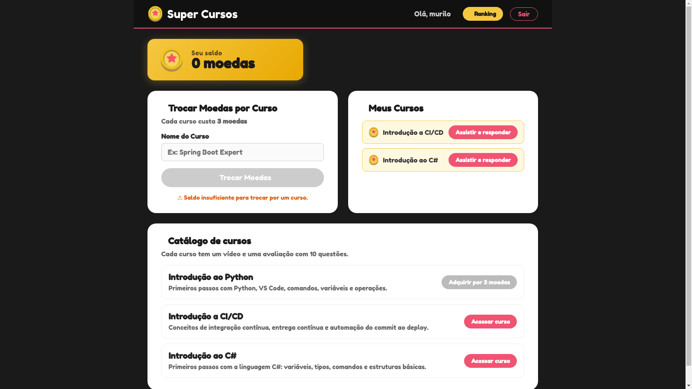

#### 13.2 Desafio 2 — Limites entre regras e persistência

**RFs:** registrar notas e apresentar o ranking. **RNFs/FURPS+:** facilidade de manutenção e testabilidade. **ASRs escolhidos:** manutenibilidade e testabilidade. **RPCs:** preservar as regras existentes e aplicar a mudança somente onde havia uma dependência concreta da persistência.

**Alternativas e decisão:** deixar o serviço do Ranking chamar Spring Data diretamente; criar uma porta de domínio e um adaptador de persistência; ou reescrever toda a aplicação em outro padrão. Foi adotada a porta `ResultadoAvaliacaoPort` com o adaptador `ResultadoAvaliacaoJpaAdapter`. Assim, o teste unitário pode substituir a porta, enquanto o teste de integração valida o PostgreSQL. O módulo Aluno ainda possui acessos diretos ao Spring Data; uma conversão completa não foi necessária para este desafio.

**ADR-002:** separar o contrato de persistência do Ranking da tecnologia JPA, sem reescrever outras áreas sem necessidade. O print abaixo confirma o fluxo de nota até o ranking.

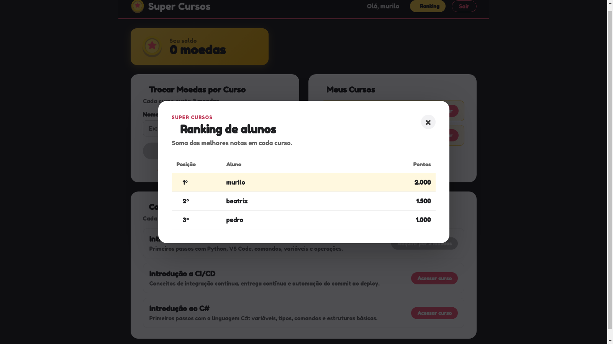

#### 13.3 Desafio 3 — Serviço Python para IA

**RFs:** recomendações e assistente educacional. **RNFs/FURPS+:** implantação independente, tolerância a falhas e interoperabilidade. **ASRs escolhidos:** deploy independente, tolerância a falhas e interoperabilidade. **RPCs:** o Core permanece em Java; o serviço de IA usa Python; sua indisponibilidade não deve impedir login, cursos, avaliações ou ranking.

**Alternativas e decisão:** executar a IA dentro do Core, mantê-la como módulo Python acoplado ou criar um serviço FastAPI separado. Foi escolhido um serviço separado, acessado pelo Core por HTTP/JSON com timeout, fallback e métrica. Busca textual e recomendações ficam juntas por enquanto para evitar operação adicional.

**ADR-003:** a IA pode ser implantada separadamente e, se ficar indisponível, o Core retorna uma resposta alternativa. O mini-lab usa busca por correspondência de palavras em textos locais; não usa LLM, embeddings nem base vetorial.

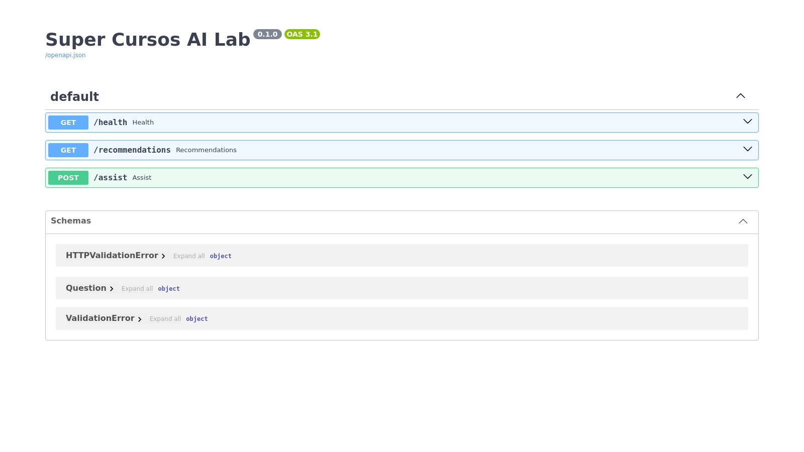

#### 13.4 Desafio 4 — Entrega de eventos com Outbox

**RFs:** registrar a conclusão de uma avaliação e permitir uma notificação posterior. **RNFs/FURPS+:** confiabilidade, recuperação e consistência. **ASRs escolhidos:** disponibilidade, recuperabilidade e consistência. **RPCs:** uma falha na notificação não pode cancelar a nota já concluída; os dados atuais estão no PostgreSQL.

**Alternativas e decisão:** chamar o consumidor por REST antes de concluir a avaliação, guardar o evento apenas em memória, adicionar um broker externo ou salvar a mensagem em uma Outbox transacional. Foi escolhida a Outbox: nota e evento `avaliacao.concluida` são gravados na mesma transação; o despachante tenta processar a mensagem depois. Se o consumidor falha, a mensagem permanece pendente e a tentativa é registrada.

**ADR-004:** manter a avaliação independente do envio de notificação. Um broker poderá ser considerado se houver vários consumidores ou volume que justifique o custo operacional.

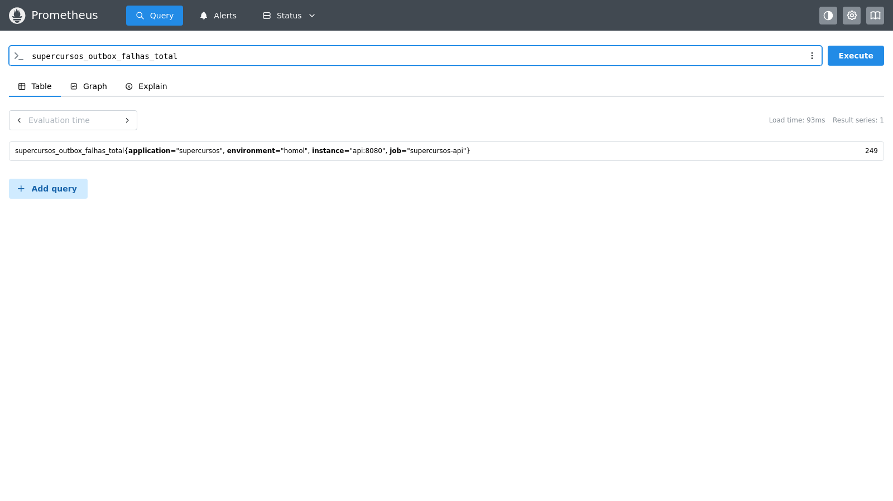

#### 13.5 Desafio 5 — Entrada IoT por MQTT

**RFs:** receber eventos de dispositivos de aprendizagem. **RNFs/FURPS+:** interoperabilidade, conectividade, disponibilidade e segurança da integração. **ASRs escolhidos:** interoperabilidade, disponibilidade com conexão instável e segurança de integração. **RPCs:** os dispositivos podem ter conexão intermitente; o Core deve receber um formato comum; o broker deste mini-lab só fica acessível na máquina local.

**Alternativas e decisão:** os dispositivos chamarem a API REST diretamente ou publicarem por MQTT com um gateway de adaptação. Foi escolhido MQTT QoS 1, Mosquitto e gateway Python que valida a mensagem e chama o Core por REST. O Core usa `eventoId` único para reconhecer reentregas e evitar duplicar o registro.

**ADR-005:** deixar o Core independente do protocolo e dos detalhes de cada dispositivo. QoS 1 significa que a mensagem pode chegar mais de uma vez; por isso a deduplicação faz parte do fluxo.

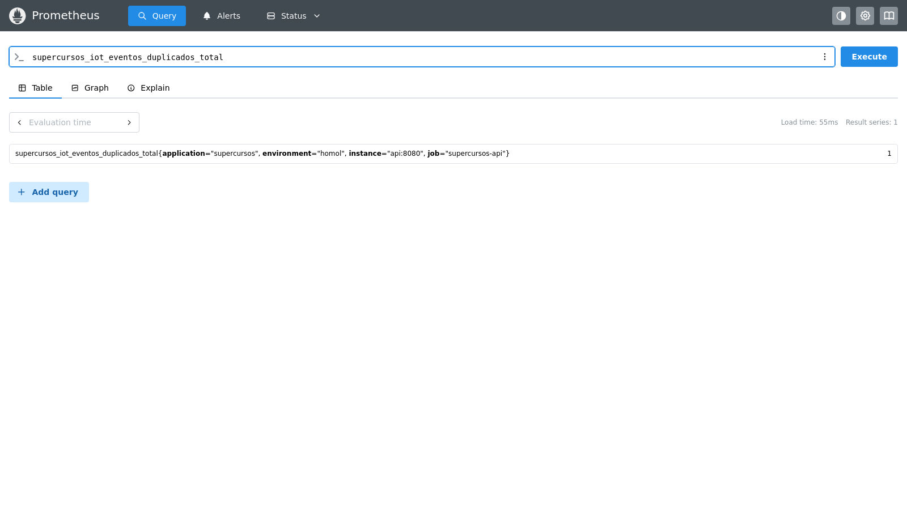

#### 13.6 Desafio 6 — Esteira e observabilidade

**RFs:** manter e publicar os componentes que atendem às funções anteriores. **RNFs/FURPS+:** testabilidade, observabilidade, confiabilidade e recuperação. **ASRs escolhidos:** observabilidade, confiabilidade e recuperabilidade. **RPCs:** Jenkins é a ferramenta definida para a esteira; Prometheus e Grafana acompanham os serviços; a equipe ainda não precisa de uma pipeline por serviço.

**Alternativas e decisão:** manter etapas manuais, criar uma pipeline por serviço ou usar uma pipeline única. Foi mantida uma pipeline Jenkins, definida em [`Jenkinsfile`](Jenkinsfile), com testes Java e PostgreSQL, JaCoCo/PMD, build dos containers, testes Python, deploy de homologação, health checks e Cypress. Prometheus coleta métricas da API, IA e gateway; Grafana apresenta os indicadores.

**ADR-006:** manter uma esteira até que ciclos de publicação diferentes justifiquem separação. A publicação no Docker Hub continua opcional.

**Resultado B1 executado localmente:** `mvn verify` terminou com sucesso: 37 testes Java e 10 testes de integração PostgreSQL, sem falhas ou erros. Os oito cenários Cypress cobrem login, compra, saldo, os três cursos do catálogo (Python, CI/CD e C#), vídeo, avaliação e ranking. Os testes Python da IA e do gateway têm dois cenários cada. O ambiente Compose e os health checks também foram conferidos.

O fallback também foi provocado com a IA parada; a [saída registrada](evidencias/B1/desafio-6/execucao-fallback.txt) mostra a resposta do Core e o contador correspondente no Prometheus.

**Evidências Jenkins:** os prints abaixo são do histórico de build, com 40 testes aprovados e JaCoCo registrado. Eles comprovam a execução anterior da esteira; o código B1 atual ainda não foi executado no Jenkins porque o servidor local não estava ativo (`localhost:9090`). O `Jenkinsfile` versionado contém a pipeline atual.


**Evidências Grafana:** o print do mini-lab B1 mostra a saúde e as métricas da API, Outbox e IoT. Os prints históricos da AC2 estão em [`evidencias/AC2/grafana/`](evidencias/AC2/grafana/).

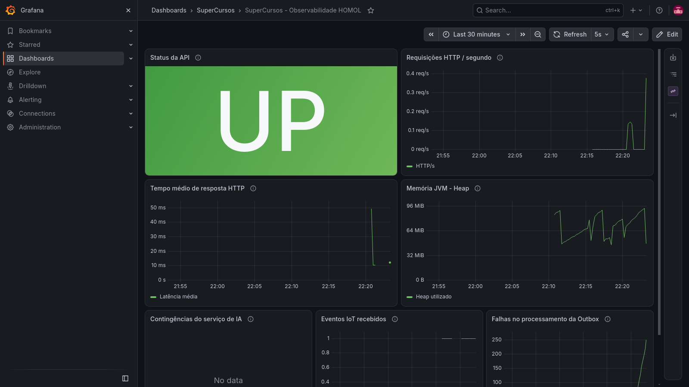

### 14. Diagramas C4 finais

#### 14.1 C4 Container

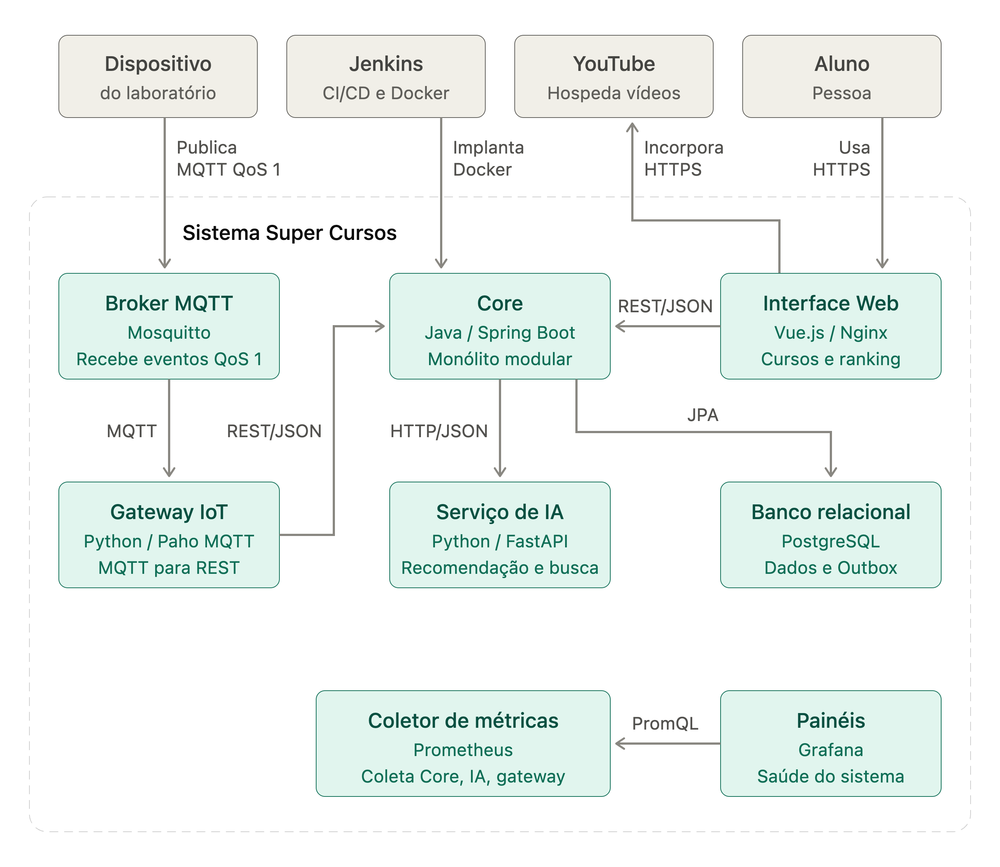

#### 14.2 C4 Component do Core

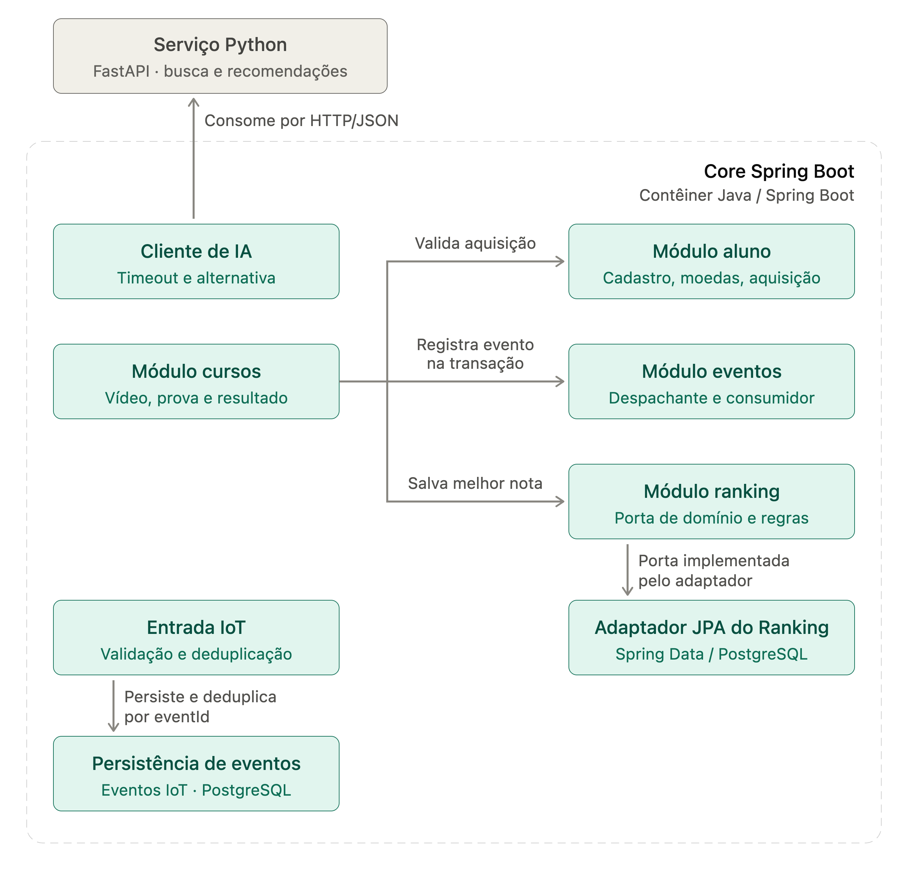

#### 14.3 Fluxo de falha da Outbox

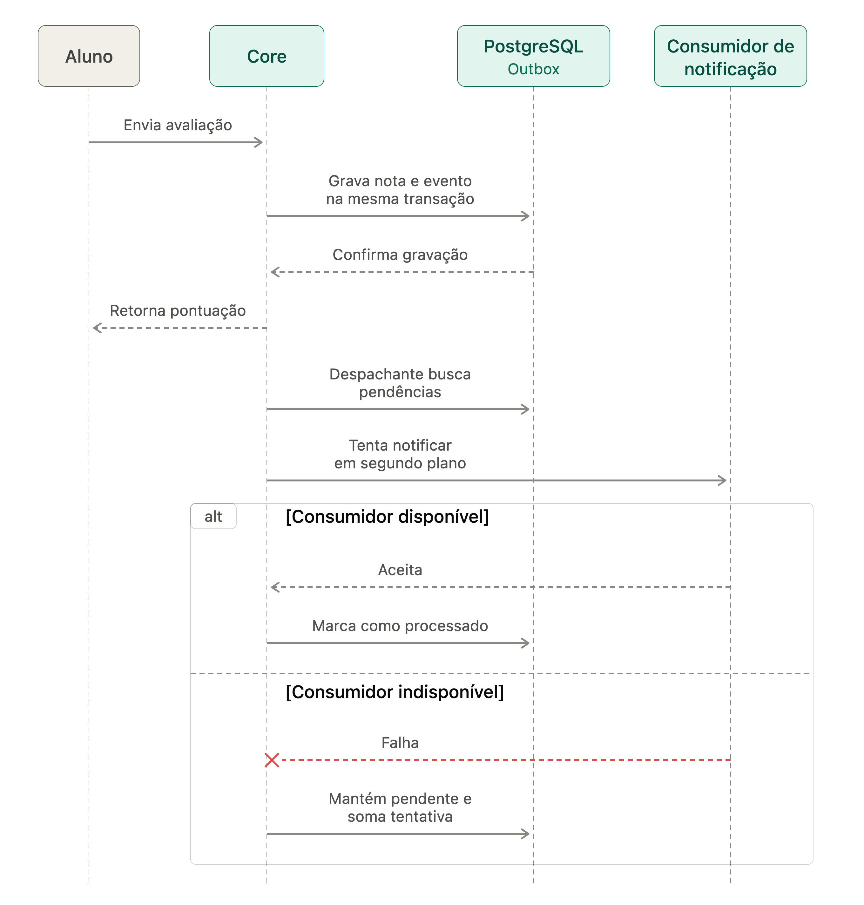

#### 14.4 C4 Deployment / operação


---
