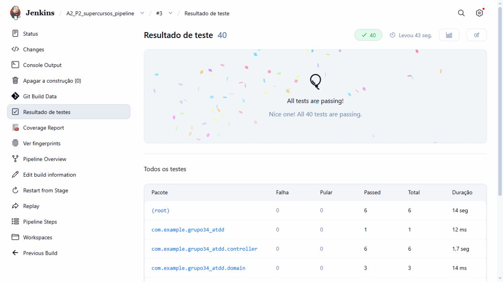

# Super Cursos - CI/CD e observabilidade

Equipe: Murilo Araujo, Beatriz Silva e Pedro Augusto.

Práticas 2 e 3 | Jenkins build #3 | 15/10/2026 às 01:40 (America/Sao_Paulo).

Commit executado: 1d37dcfeb7767ae2b06420eaebad2ea7fced5938. Repositório de origem: https://github.com/MuriloAras/devops-ac1.

O sistema da AC1 foi ampliado com um pipeline versionado, testes de integração PostgreSQL, containers do frontend e backend, Cypress e monitoramento. A validação inicial da AC1 foi dispensada pelo aluno; esta entrega registra as novas práticas e as execuções efetivamente realizadas.

| Verificação | Resultado |
| --- | --- |
| Jenkins | SUCCESS - build #3 |
| JUnit / PostgreSQL | 26 testes de unidade + 8 de integração; zero falhas |
| Cypress | 6 cenários aprovados; seis capturas e vídeo |
| JaCoCo | Linhas 98,80%; branches 100,00% |
| Homologação | Seis serviços saudáveis; API UP; Prometheus up=1; Grafana operacional |

## Prática 2 - Pipeline as Code

Job: A2_P2_supercursos_pipeline. O Jenkins usa Pipeline script from SCM e lê o Jenkinsfile da branch devops/praticas-2-3. Nesta máquina, o SCM aponta à cópia Git local, vinculada ao repositório de origem; o disparo do build é manual. Não há webhook nem polling configurado.

| Estágio | Responsabilidade |
| --- | --- |
| 0 - Preflight | Verificar Java, Git, Docker Engine e Compose. |
| 1 - Checkout | Obter a revisão e registrar job, build, commit e tag. |
| 2 - CI | Executar JUnit e PostgreSQL/Testcontainers; publicar JUnit e JaCoCo. |
| 3 - PMD | Gerar e arquivar análise estática. |
| 4 - Package | Empacotar o JAR após aprovação dos testes. |
| 5 - Containers | Construir API Java 21 e frontend Vue/Nginx. |
| 6 - Registry | Publicação Docker Hub opcional; desabilitada nesta execução. |
| 7 - Deploy | Subir HOMOL e aguardar saúde dos seis serviços. |
| 8 - Health | Confirmar /actuator/health e registrar containers. |
| 9 - Cypress | Validar seis cenários na aplicação implantada. |
| 10 - Observabilidade | Apresentar URLs para a conferência das métricas e painéis. |

Uma falha de teste interrompe o avanço para os estágios seguintes. O PMD gera relatório sem gate de violações, e não foi criado um limiar arbitrário de cobertura. As imagens usam a tag do número do build. A publicação remota de imagens permaneceu desabilitada.

## Evidência do Jenkins - build #3

O console integral, a configuração XML do job, o JSON dos estágios e os relatórios estão preservados na pasta de evidências P2 desta execução. As capturas antigas da AC1 permanecem separadas.

## Qualidade e testes automatizados

Os testes de integração usam PostgreSQL 16 em container temporário e porta aleatória, sem acessar o volume de homologação. Verificam persistência, cursos, regras de saldo, e-mail único e respostas HTTP de saúde, métricas e OpenAPI.

## Cobertura JaCoCo e análise PMD

O XML JaCoCo registra linhas 98,80%, instruções 99,10% e branches 100,00%. O plugin Jenkins arredonda os percentuais na apresentação. Duas linhas do método main existente não foram cobertas.

O relatório PMD desta execução não registrou ocorrências nas regras padrão. Os XML e HTML acompanham as evidências para conferência dos resultados, além das imagens.

O Jenkins publica a cobertura pelo plugin JaCoCo 3.3.7; o Maven gera os dados com jacoco-maven-plugin 0.8.13. A cópia local da apresentação indicada no Canvas mostra o uso de Record JaCoCo coverage report, sem uma versão numérica obrigatória identificada. A conferência e o inventário estão em docs/CONFERENCIA_PLUGINS_JENKINS.md.

## Prática 3 - Containers e homologação

O projeto Compose supercursos-homol separa containers, rede e volumes do laboratório anterior. O frontend é Vue estático servido por Nginx, com proxy /api para api:8080. O backend usa o perfil homol com PostgreSQL; o perfil dev mantém H2 por padrão.

| Serviço | Acesso local |
| --- | --- |
| Frontend | http://localhost:3002 |
| API / health | http://localhost:8082/actuator/health |
| pgAdmin | http://localhost:5051 |
| Prometheus | http://localhost:9092/targets |
| Grafana | http://localhost:3003/d/supercursos-homol |
| PostgreSQL 16 | Somente rede interna Docker |

Health check registrado em /actuator/health: {"groups":["liveness","readiness"],"status":"UP"}. A resposta JSON e a captura original do navegador estão preservadas em evidencias/a2/p3/.

A coleta registra os seis containers em execução e saudáveis. Os healthchecks abrangem API, frontend, PostgreSQL, pgAdmin, Prometheus e Grafana. Os arquivos containers.txt e containers.json preservam os estados e as portas reais.

## Cypress - regras do Super Cursos

| Cenário | Comprovação |
| --- | --- |
| Login inválido | HTTP 401 e permanência na tela de login. |
| Login válido | Saldo inicial e lista de cursos apresentados. |
| 3 moedas | Curso adquirido e saldo final zero. |
| 5 moedas | Curso adquirido e saldo final duas moedas. |
| 2 moedas | Botão bloqueado, API 400 e dados inalterados. |
| Persistência | Curso e saldo mantidos após sair e entrar. |

Cada cenário cria um aluno fictício com e-mail único pela API. Os testes não substituem respostas por mocks; observam as requisições reais e verificam os dados persistidos. O JUnit, as seis capturas de sucesso e o vídeo estão na pasta Cypress da execução.

## Prometheus e Grafana

O Prometheus coleta /actuator/prometheus do serviço api:8080 sob o job supercursos-api. O Grafana consulta esse datasource. A verificação registrou o target UP e a consulta up{job="supercursos-api"} com valor 1.

## Dashboard de observabilidade

Os quatro painéis mostram disponibilidade da coleta, requisições HTTP por segundo, tempo médio de resposta e memória JVM Heap. Foi gerado tráfego real na aplicação e aguardada a coleta; as consultas e o dashboard exportado acompanham as evidências.

## Análise das práticas e encerramento

## Prática 2

### Qual a principal diferença entre configurar a esteira no Freestyle e defini-la em Jenkinsfile?

No Freestyle, as etapas são configuradas principalmente nos formulários do job no Jenkins. Com o Jenkinsfile, a sequência de checkout, testes, análise, empacotamento e implantação fica descrita em código no repositório do Super Cursos. Isso permite revisar alterações e recuperar a definição correspondente a cada commit, desde que o nó de execução Jenkins tenha as ferramentas e permissões necessárias.

### Por que versionar o pipeline junto ao código?

O versionamento mantém a esteira alinhada às mudanças da aplicação, dos testes e dos arquivos Docker. Neste trabalho, o job lê o Jenkinsfile de um repositório Git local e registra o commit utilizado; o disparo é manual, sem webhook. Assim, o histórico permite identificar qual configuração foi executada, embora o início da execução dependa da ação do usuário.

### Se o estágio de testes falhar, os estágios de container/deploy devem continuar? Justifique.

Não. Uma falha nos testes JUnit ou de integração com PostgreSQL deve interromper o pipeline antes da criação das imagens e da implantação em homologação. O código de saída do Maven impede o avanço, enquanto os relatórios de testes e cobertura ajudam a investigar o problema. A existência de um relatório JaCoCo ou PMD, por si só, não comprova aprovação funcional.

### Qual estágio representa a transição mais clara entre CI e CD?

Nesta organização da esteira, a transição ocorre no estágio 5, de construção dos containers. A CI reúne checkout, JUnit, testes de integração, JaCoCo, relatório PMD e empacotamento; a partir daí, as imagens da API e do frontend são preparadas para implantação em homologação, seguida de health check e Cypress. A publicação no Docker Hub é uma etapa opcional e não é necessária para executar as imagens no Docker local.

## Prática 3

### Por que um BUILD SUCCESS não garante que a aplicação implantada esteja operacional?

Um BUILD SUCCESS do Maven confirma apenas as etapas executadas naquele build. Mesmo com testes de integração em um PostgreSQL descartável, a implantação em homologação ainda pode apresentar falhas de configuração, rede, portas ou conexão com o banco persistente. Por isso, a esteira também verifica a saúde da API e executa Cypress sobre o fluxo real Vue/Nginx → API Spring Boot → PostgreSQL.

### Qual é a função do Health Check no CD?

O health check verifica se a aplicação está pronta para atender requisições e se suas dependências essenciais respondem. No Super Cursos, o Compose verifica o PostgreSQL e o endpoint `/actuator/health` da API antes de iniciar os serviços dependentes; o Jenkins consulta novamente esse endpoint após o deploy. Essa verificação prepara o ambiente para o Cypress, que valida o comportamento funcional da aplicação.

### Qual é o papel do Docker Compose no ambiente de homologação?

O Docker Compose descreve e conecta PostgreSQL, pgAdmin, API, frontend Nginx, Prometheus e Grafana, além do serviço Cypress utilizado nos testes. Ele concentra configuração de rede, volumes, portas e dependências de inicialização. O Nginx serve a aplicação Vue e encaminha as chamadas `/api` ao backend, que aplica as regras de negócio e persiste os dados no PostgreSQL.

### Qual é a relação entre Prometheus e Grafana? Explique por que o Prometheus coleta/armazena métricas e o Grafana consulta essas métricas para visualização.

O Prometheus consulta periodicamente `/actuator/prometheus` e armazena as métricas como séries temporais. O Grafana usa esse Prometheus como fonte de dados e executa consultas PromQL para apresentar quatro painéis: disponibilidade da coleta da API, requisições HTTP por segundo, tempo médio de resposta e memória heap da JVM. O indicador `up` informa se a coleta funcionou; os demais gráficos precisam ser interpretados junto ao tráfego e ao período observado.

## Encerramento

### Em que ponto da A2 termina a Integração Contínua e começa a Entrega/Implantação Contínua?

Nesta esteira, a CI termina no empacotamento após as verificações de código e testes; a entrega avança com a construção das imagens e sua publicação opcional no Docker Hub. A implantação automatizada ocorre no ambiente de homologação, onde o pipeline inicia os serviços, verifica a saúde da API e executa os testes de ponta a ponta. O job é iniciado manualmente, e o Jenkins automatiza a sequência a partir desse disparo.

### Qual vantagem arquitetural o Jenkinsfile oferece em relação à configuração exclusivamente Freestyle?

O Jenkinsfile torna o processo de entrega uma definição versionada junto à aplicação. Ele explicita a ordem das etapas e as condições de falha, permitindo revisar mudanças e relacionar cada execução a um commit. Isso facilita reconstruir o job em outro Jenkins, desde que também sejam preparados os plugins, o nó de execução, o acesso ao Docker e eventuais credenciais exigidas pela configuração.

### Por que JUnit deve ser executado antes da criação/deploy do container e Cypress depois do deploy?

JUnit permite verificar cedo a lógica e os contratos da aplicação; os testes de integração acrescentam a persistência em um PostgreSQL descartável antes da implantação. Cypress precisa dos serviços implantados para exercitar a aplicação pelo navegador. No Super Cursos, os cenários incluem login válido e inválido, troca com 3 moedas terminando em 0, troca com 5 terminando em 2, bloqueio com saldo 2 e preservação do curso após novo login; o saldo insuficiente também é conferido diretamente na API.

### Como observabilidade se relaciona com a qualidade de uma aplicação após sua implantação?

A observabilidade permite acompanhar o comportamento da aplicação enquanto ela está em execução e complementar os resultados dos testes. Os quatro painéis do Super Cursos ajudam a identificar indisponibilidade de coleta, variações de tráfego, aumento de latência e crescimento do consumo de memória. Esses sinais orientam a investigação, mas não substituem os testes das regras de troca de moedas nem comprovam, isoladamente, a causa de uma falha.

### Qual conhecimento do Exercício A1 foi reutilizado diretamente na construção desta esteira?

Foram reutilizados os cenários BDD e a prática de testar as regras de negócio com JUnit, medir cobertura com JaCoCo e organizar domínio, serviços, controladores e persistência. A configuração Docker inicial e o frontend Vue também serviram de base. Nesta continuação, esses elementos passam a integrar uma esteira Jenkins com análise PMD, testes de integração em PostgreSQL e validação de ponta a ponta com Cypress.

### Conclusão: O que mudou arquiteturalmente do Exercício A1 para o Exercício A2?

A A2 acrescenta ao Super Cursos um processo de entrega descrito em Jenkinsfile, um ambiente Docker completo e verificações automatizadas antes e depois da implantação. O fluxo da aplicação permanece centrado no Vue servido pelo Nginx, na API Spring Boot e no PostgreSQL; a evolução está na integração desse conjunto com testes, relatórios, health checks e monitoramento Prometheus/Grafana. Dessa forma, a avaliação passa a considerar tanto o código quanto o funcionamento do sistema em homologação.

## Rastreabilidade e reprodução

Manifesto da coleta: evidencias/a2/p2/build-3-20261015T044637939Z/manifesto-coleta.json. Status: VERIFICADO. Build #3, commit 1d37dcfeb7767ae2b06420eaebad2ea7fced5938.

A configuração do job aponta ao Git local desta máquina. A branch contém as alterações; a origem remota é MuriloAras/devops-ac1. A publicação desta branch no GitHub e o Docker Hub não fazem parte da execução local registrada aqui.

Para reproduzir: siga docs/PRATICAS_A2.md, configure o job com scripts/configurar-jenkins.ps1, execute o build e, após SUCCESS, rode scripts/coletar-evidencias.ps1. O arquivo .env não é versionado e não acompanha o SCM ao workspace Jenkins.

O coletor verifica o build e o commit, os resultados JUnit e Cypress, a saúde da API e o monitoramento, e registra hashes SHA-256 dos relatórios e mídias. As capturas do navegador complementam esses arquivos. As credenciais exibidas no exemplo são exclusivas do laboratório local.

Todas as novas capturas usam formato desktop wide, próximo de 16:9: cerca de 1280 x 720 no navegador e 1600 x 900 no Cypress. O índice evidencias/a2/README.md lista os arquivos e suas dimensões. Os relatórios de execuções anteriores foram preservados no histórico local, e esta entrega usa a coleta do build atual.

Referências técnicas: documentação Jenkins de Pipeline e API remota (jenkins.io/doc); matriz de compatibilidade Springdoc (springdoc.org); documentação Docker Compose (docs.docker.com/compose); documentação Cypress (docs.cypress.io); Prometheus e Grafana (prometheus.io/docs e grafana.com/docs).
