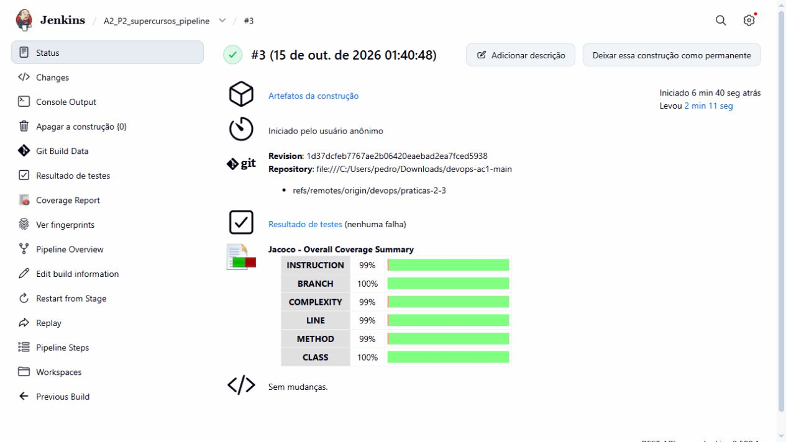
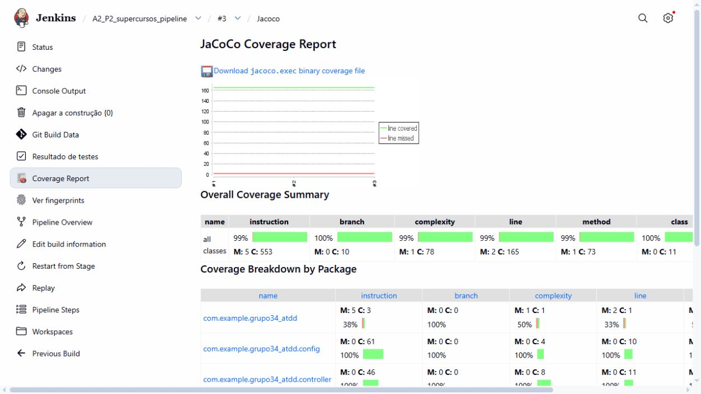
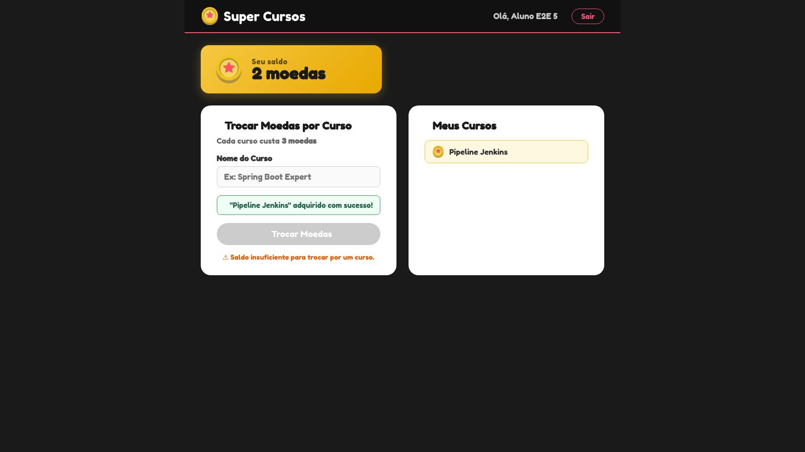
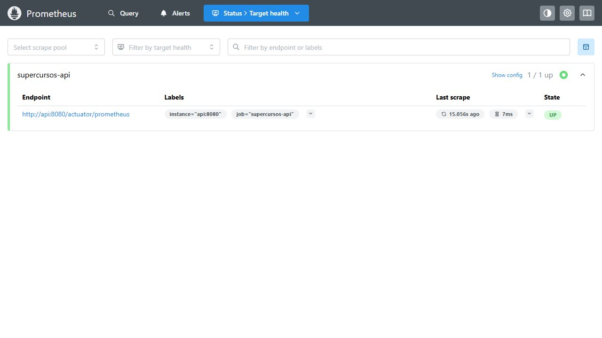
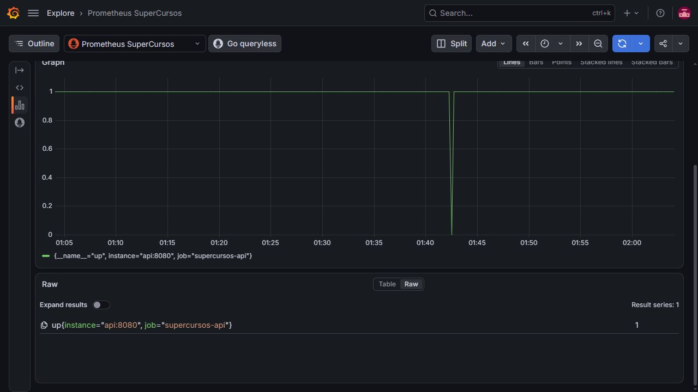
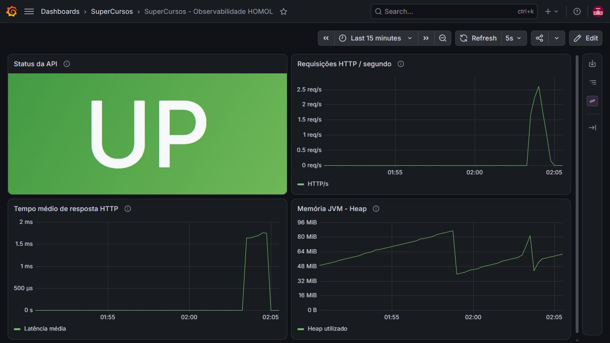

# Super Cursos - CI/CD e observabilidade

Equipe: Murilo Araujo, Beatriz Silva e Pedro Augusto.

Jenkins build #3 | 15/10/2026 às 01:40 (America/Sao_Paulo).

Commit executado: 1d37dcfeb7767ae2b06420eaebad2ea7fced5938. Repositório de origem: https://github.com/MuriloAras/devops-ac1.

| Verificação | Resultado |
| --- | --- |
| Jenkins | SUCCESS - build #3 |
| JUnit / PostgreSQL | 26 testes de unidade + 8 de integração; zero falhas |
| Cypress | 6 cenários aprovados; seis capturas e vídeo |
| JaCoCo | Linhas 98,80%; branches 100,00% |
| Homologação | Seis serviços saudáveis; API UP; Prometheus up=1; Grafana operacional |

## Pipeline as Code

Job: A2_P2_supercursos_pipeline. Branch: devops/praticas-2-3. Pipeline script from SCM; Git local; acionamento manual.

| Estágio | Responsabilidade |
| --- | --- |
| 0 - Preflight | Verificar Java, Git, Docker Engine e Compose. |
| 1 - Checkout | Obter a revisão e registrar job, build, commit e tag. |
| 2 - CI | Executar JUnit e PostgreSQL/Testcontainers; publicar JUnit e JaCoCo. |
| 3 - PMD | Gerar e arquivar análise estática. |
| 4 - Package | Empacotar o JAR após aprovação dos testes. |
| 5 - Containers | Construir API Java 21 e frontend Vue/Nginx. |
| 6 - Registry | Publicação Docker Hub opcional; desabilitada nesta execução. |
| 7 - Deploy | Subir HOMOL e aguardar saúde dos seis serviços. |
| 8 - Health | Confirmar /actuator/health e registrar containers. |
| 9 - Cypress | Validar seis cenários na aplicação implantada. |
| 10 - Observabilidade | Apresentar URLs para a conferência das métricas e painéis. |

Testes: bloqueio em caso de falha. PMD: informativo. Cobertura: sem limite mínimo. Tag das imagens: número do build. Docker Hub: desabilitado.

## Evidência do Jenkins - build #3

## Qualidade e testes automatizados

JUnit: 26 testes de unidade. PostgreSQL 16 / Testcontainers: 8 testes de integração. Cypress: 6 testes E2E. Total: 40 aprovados.

## Cobertura JaCoCo e análise PMD

JaCoCo: linhas 98,80%; instruções 99,10%; branches 100,00%.

PMD: zero ocorrências. JaCoCo Jenkins: 3.3.7. jacoco-maven-plugin: 0.8.13.

## Containers e homologação

Compose: supercursos-homol. Frontend: Vue/Nginx. API: Spring Boot. Banco: PostgreSQL 16. Proxy: /api → api:8080.

| Serviço | Acesso local |
| --- | --- |
| Frontend | http://localhost:3002 |
| API / health | http://localhost:8082/actuator/health |
| pgAdmin | http://localhost:5051 |
| Prometheus | http://localhost:9092/targets |
| Grafana | http://localhost:3003/d/supercursos-homol |
| PostgreSQL 16 | Somente rede interna Docker |

Health check: {"groups":["liveness","readiness"],"status":"UP"}. Containers saudáveis: API, frontend, PostgreSQL, pgAdmin, Prometheus e Grafana.

## Cypress - regras do Super Cursos

| Cenário | Comprovação |
| --- | --- |
| Login inválido | HTTP 401 e permanência na tela de login. |
| Login válido | Saldo inicial e lista de cursos apresentados. |
| 3 moedas | Curso adquirido e saldo final zero. |
| 5 moedas | Curso adquirido e saldo final duas moedas. |
| 2 moedas | Botão bloqueado, API 400 e dados inalterados. |
| Persistência | Curso e saldo mantidos após sair e entrar. |

## Prometheus e Grafana

Endpoint: api:8080/actuator/prometheus. Job: supercursos-api. Target: UP. Consulta: up{job="supercursos-api"}=1.

## Dashboard de observabilidade

Painéis: disponibilidade, requisições HTTP/s, latência média e memória JVM Heap.

## Análise técnica

## Pipeline as Code

### Qual a principal diferença entre configurar a esteira no Freestyle e defini-la em Jenkinsfile?

No Freestyle, as etapas são configuradas nos formulários do job. No Super Cursos,
o `Jenkinsfile` descreve checkout, testes, análise, empacotamento e implantação no
Git, permitindo revisar mudanças e recuperar a definição de cada execução.

### Por que versionar o pipeline junto ao código?

O versionamento mantém a esteira alinhada à aplicação, aos testes e aos arquivos
Docker. O job registra o commit utilizado, permitindo identificar a configuração
executada. O disparo atual é manual, sem webhook ou polling.

### Se o estágio de testes falhar, os estágios de container/deploy devem continuar? Justifique.

Não. Uma falha nos testes JUnit ou de integração PostgreSQL interrompe o pipeline
antes da construção das imagens e do deploy. O código de saída do Maven impede
o avanço; os relatórios JUnit e JaCoCo permitem investigar a falha.

### Qual estágio representa a transição mais clara entre CI e CD?

O estágio 5, de construção dos containers. A CI reúne checkout, testes, cobertura,
PMD e empacotamento do JAR. As imagens da API e do frontend seguem para homologação,
health checks e Cypress. A publicação Docker Hub é opcional.

## Containers e homologação

### Por que um BUILD SUCCESS não garante que a aplicação implantada esteja operacional?

O sucesso do Maven confirma as verificações executadas, mas a implantação pode
apresentar problemas de configuração, rede ou conexão com o banco persistente.
Os health checks e o Cypress verificam o ambiente implantado:
Vue/Nginx → API Spring Boot → PostgreSQL.

### Qual é a função do Health Check no CD?

Verificar se os serviços e suas dependências estão prontos. O Compose aguarda
o PostgreSQL e o endpoint `/actuator/health` da API antes de iniciar serviços
dependentes. O Jenkins consulta a saúde da API novamente após o deploy.

### Qual é o papel do Docker Compose no ambiente de homologação?

Definir e conectar PostgreSQL, pgAdmin, API, frontend Nginx, Prometheus e Grafana,
além do Cypress. O Compose concentra rede, volumes, portas, variáveis e
dependências de inicialização. O Nginx serve o Vue e encaminha `/api` ao backend.

### Qual é a relação entre Prometheus e Grafana?

O Prometheus coleta `/actuator/prometheus` e armazena as métricas como séries
temporais. O Grafana consulta essas séries e apresenta disponibilidade da coleta,
HTTP/s, latência média e heap JVM. A métrica `up=1` confirma o sucesso da coleta.

## Integração e operação

### Em que ponto termina a Integração Contínua e começa a Entrega/Implantação Contínua?

A CI termina no empacotamento, após os testes e verificações de código. A entrega
avança com a construção das imagens e a publicação opcional no Docker Hub.
A implantação em homologação inclui inicialização dos serviços, health checks
e testes E2E. O Jenkins automatiza essa sequência após o disparo manual do job.

### Qual vantagem arquitetural o Jenkinsfile oferece em relação à configuração exclusivamente Freestyle?

O `Jenkinsfile` explicita a ordem das etapas e as condições de falha, relacionando
cada execução a um commit. Para reproduzir o job, o nó de execução precisa dos
plugins, ferramentas, acesso ao Docker e credenciais indicados na configuração.

### Por que JUnit deve ser executado antes da criação/deploy do container e Cypress depois do deploy?

JUnit verifica a lógica e os contratos antes da implantação; os testes de integração
validam a persistência em PostgreSQL descartável. Cypress usa os serviços
implantados para exercitar login, troca de moedas, saldo insuficiente e
persistência dos cursos pelo navegador e pela API.

### Como observabilidade se relaciona com a qualidade de uma aplicação após sua implantação?

Os quatro painéis permitem acompanhar indisponibilidade de coleta, variações de
tráfego, latência e consumo de memória durante a execução. As métricas orientam
a investigação e complementam os testes das regras de negócio.

### Como os componentes formam o fluxo de entrega do Super Cursos?

O Git fornece o código e o `Jenkinsfile`. O Jenkins executa testes, relatórios e
build das imagens; o Compose implanta o ambiente; o Cypress verifica os fluxos
funcionais; Prometheus e Grafana permitem acompanhar o sistema em homologação.

## Rastreabilidade e reprodução

Manifesto da coleta: evidencias/AC2/p2/build-3-20261015T044637939Z/manifesto-coleta.json. Status: VERIFICADO. Build #3, commit 1d37dcfeb7767ae2b06420eaebad2ea7fced5938.

SCM: Git local. Branch: devops/praticas-2-3. Publicação remota: não realizada nesta execução.

Execução: scripts/configurar-jenkins.ps1 → build Jenkins → scripts/coletar-evidencias.ps1. Guia: docs/PRATICAS_A2.md.

Capturas: desktop wide, aproximadamente 1280 x 720 no navegador e 1600 x 900 no Cypress. Evidências: evidencias/AC2/.
