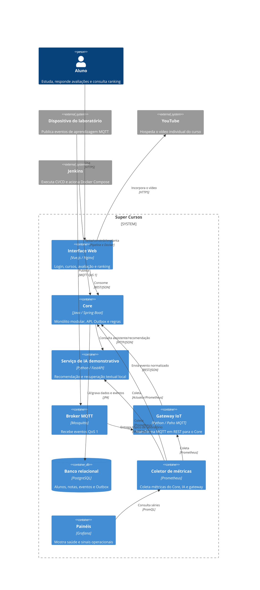
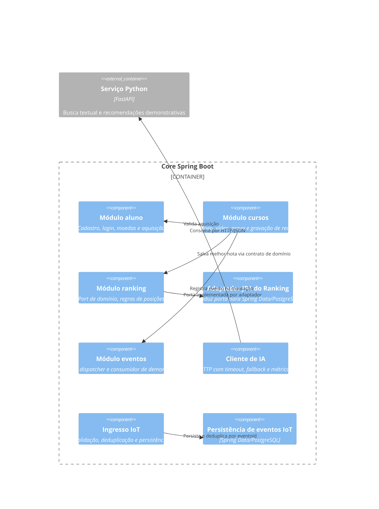
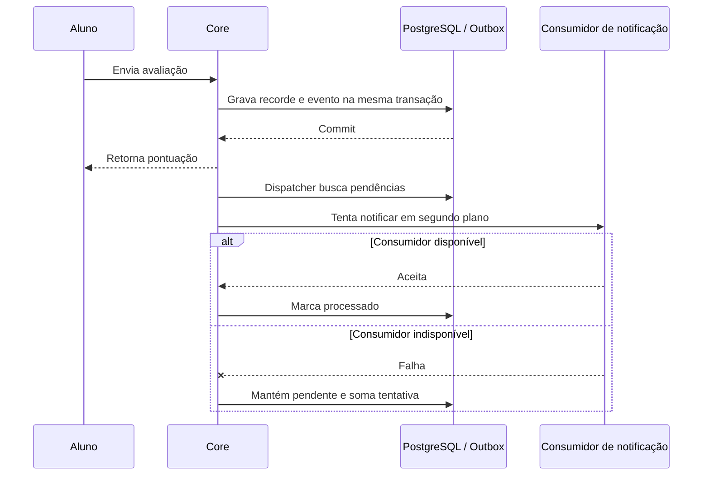

# Registro arquitetural B1 do Super Cursos

Este registro reúne as decisões dos seis desafios do Architecture Lab e as microsoluções que as exercitam. A equipe considerada é a equipe real do projeto, com três integrantes. O Core continua em Java/Spring Boot e PostgreSQL; a implementação evolui de forma incremental, sem presumir que a previsão de 100.000 usuários prove por si só a necessidade de microsserviços.

**Repositório:** [github.com/MuriloAras/devops-ac1](https://github.com/MuriloAras/devops-ac1)

## Resumo das decisões

| Desafio | Decisão | Evidência principal |
| --- | --- | --- |
| 1 — Drivers e evolução do Core | Adotar monólito modular para Aluno, Cursos e Ranking. | Comparação dos pacotes antes/depois, testes e C4. |
| 2 — Organização interna | Inverter a dependência da persistência do Ranking por `ResultadoAvaliacaoPort`; JPA é um adaptador substituível. | Testes unitários com porta substituída e integração PostgreSQL. |
| 3 — Python e IA | Manter recomendação/assistente em serviço FastAPI separado, com cliente HTTP no Core e fallback. | Pergunta ao serviço local e teste com serviço indisponível. |
| 4 — Eventos | Gravar conclusão de avaliação em uma Outbox na mesma transação; processar notificação em segundo plano. | Teste de falha do consumidor: evento permanece pendente e tentativa é contada. |
| 5 — IoT e MQTT | Receber dispositivos por MQTT QoS 1 em gateway, transformar para REST do Core e deduplicar por `eventoId`. | Simulador, persistência PostgreSQL e teste de reentrega. |
| 6 — CI/CD e observabilidade | Manter pipeline único para o monólito e os serviços auxiliares, com testes, health checks, Cypress e métricas Prometheus/Grafana. | `Jenkinsfile`, teste de indisponibilidade da IA e métrica no Prometheus. |

## Requisitos e restrições por desafio

Os RNFs abaixo estão agrupados pelas qualidades FURPS+ mais próximas. A coluna ASR aponta somente os atributos selecionados para orientar a decisão; cada desafio usa no máximo três.

| Desafio | RFs afetados | RNFs relevantes (FURPS+) | ASRs selecionados | RPCs e premissas |
| --- | --- | --- | --- | --- |
| 1 — Core | RF01 Ranking; RF02 Conquistas e evolução das funções existentes. | Manutenibilidade (suporte); desempenho e escalabilidade (desempenho); complexidade operacional (operação/custo). | Manutenibilidade; escalabilidade futura; complexidade operacional. | Core existente em Java/Spring Boot; banco relacional; legado da AC1; equipe considerada com três integrantes; não há medição de carga. |
| 2 — Organização interna | RF01 Ranking; RF02 Conquistas e regras de gamificação. | Manutenibilidade, testabilidade e facilidade de mudança (suporte). | Manutenibilidade; testabilidade. | Manter Spring Boot e reaproveitar regras existentes; não reescrever a aplicação inteira apenas para adotar um padrão. |
| 3 — Python e IA | RF03 Recomendação inteligente; RF04 Assistente educacional. | Publicação independente (implantação); escala e desempenho (desempenho); tolerância a falhas (confiabilidade); interoperabilidade (interfaces); manutenibilidade (suporte). | Publicação independente; tolerância a falhas; interoperabilidade. | Core continua em Java/Spring Boot; ML/RAG usam Python; falha da IA não pode bloquear operações essenciais. |
| 4 — Eventos | RF02 Conquistas; RF05 Notificações; eventos de conclusão de atividade. | Disponibilidade e tolerância a falhas (confiabilidade); latência (desempenho); consistência e recuperação (confiabilidade); desacoplamento (suporte). | Disponibilidade; recuperação; consistência. | Fluxos essenciais do Core devem concluir se o consumidor externo estiver indisponível; broker acrescenta custo operacional. |
| 5 — IoT | RF06 Receber eventos de dispositivos e encaminhá-los à plataforma. | Interoperabilidade (interfaces); eficiência e escala (desempenho); disponibilidade com conexão instável (confiabilidade); segurança de integração (segurança). | Interoperabilidade; disponibilidade/conectividade; segurança de integração. | Dispositivos têm recursos limitados e conexão intermitente; protocolo e broker acrescentam componentes para operar. |
| 6 — CI/CD e observabilidade | Todos os RFs atendidos pelos componentes; operação e evolução do sistema. | Observabilidade e testabilidade (suporte); publicação (implantação); confiabilidade e recuperação (confiabilidade); desempenho (desempenho). | Observabilidade; confiabilidade; recuperação. | Jenkins é a base da esteira; Prometheus/Grafana são as ferramentas do laboratório; configurações e evidências devem ser versionadas. |

## Matriz cumulativa de ASRs

Foram escolhidos no máximo três atributos por desafio, apenas quando podem alterar estrutura, comunicação, dados, implantação ou operação.

| Desafio | ASR prioritário | Efeito arquitetural | Como foi tratado |
| --- | --- | --- | --- |
| 1 | Manutenibilidade | Fronteiras de negócio reduzem impacto de mudanças. | Módulos `aluno`, `cursos` e `ranking`. |
| 1 | Escalabilidade futura | Ranking pode ser observado e extraído se medições mostrarem necessidade. | Fronteira explícita, sem serviço separado prematuro. Não há teste de carga de 100 mil usuários. |
| 1 | Complexidade operacional | A equipe de três integrantes precisa operar algo proporcional. | Core permanece um processo e um banco. |
| 2 | Manutenibilidade | Regras de negócio não devem depender da tecnologia de banco. | Port de domínio e adaptador Spring Data/JPA. |
| 2 | Testabilidade | Deve ser possível testar caso de uso sem PostgreSQL. | Testes substituem a porta; integração valida o adaptador real. |
| 3 | Deploy independente | Python tem runtime e ciclo de atualização distintos do Core. | Container FastAPI próprio, consumido por HTTP. |
| 3 | Tolerância a falhas | Indisponibilidade da IA não pode bloquear o Core. | Timeout curto e resposta alternativa Java; métrica de fallback. |
| 3 | Interoperabilidade | Core Java e serviço Python precisam de contrato estável. | JSON via HTTP com rotas explícitas. |
| 4 | Disponibilidade | Falha de notificação não deve desfazer a avaliação. | Evento gravado transacionalmente na Outbox e processado depois. |
| 4 | Recuperabilidade | Evento não entregue precisa permanecer recuperável. | Pendências e tentativas persistem no PostgreSQL. |
| 4 | Consistência | Avaliação e evento associado devem ser gravados juntos. | Mesma transação de aplicação. |
| 5 | Interoperabilidade | Dispositivo limitado usa MQTT; Core recebe contrato web comum. | Gateway converte MQTT para REST. |
| 5 | Disponibilidade/conectividade | Mensagem pode precisar de reentrega. | QoS 1, confirmação manual depois do aceite do Core e chave idempotente. |
| 5 | Segurança de integração | Broker exposto publicamente seria risco. | Broker anônimo restrito ao host local neste mini-lab. Não é configuração de produção. |
| 6 | Observabilidade | Falhas entre serviços precisam ser visíveis. | Métricas API, IA e gateway coletadas pelo Prometheus; painéis Grafana. |
| 6 | Confiabilidade | Só implantar após qualidade e saúde básicas. | Testes, health checks, E2E e etapas que falham a esteira. |
| 6 | Recuperabilidade | Falhas devem permitir diagnóstico e retomada. | Logs, métricas, eventos Outbox persistidos e artefatos de execução. |

## RPCs e premissas consideradas

| RPC | Consequência |
| --- | --- |
| Core legado em Java/Spring Boot, regras e PostgreSQL existentes | Preservar contratos do aluno e evoluir sem reescrever o produto. |
| Equipe do projeto com três integrantes | Preferir uma esteira e operação simples enquanto isso atender aos drivers. |
| O case exige serviços Python para IA | IA demonstra uma fronteira HTTP; o Core continua sendo dono dos fluxos essenciais. |
| Notificação pode falhar sem bloquear conclusão | Usar entrega eventual recuperável; não fazer chamada síncrona obrigatória. |
| Dispositivos IoT têm recursos limitados e conectividade instável | MQTT na entrada, gateway adaptador e deduplicação no Core. |
| Jenkins, Prometheus e Grafana são as ferramentas do laboratório | Manter `Jenkinsfile`, configuração e dashboard versionados no repositório. |
| Não há meta de carga medida nem credenciais de IA/MQTT de produção | Mini-labs locais verificam fronteiras e falhas; não alegam capacidade produtiva. |

## Alternativas e trade-offs

| Tema | Alternativas | Decisão e custo aceito |
| --- | --- | --- |
| Core (D1) | Monólito em camadas; monólito modular; serviços independentes. | Monólito modular: fronteiras claras com deploy simples. Módulos não escalam separadamente. |
| Dependências internas (D2) | JPA chamado diretamente pelo caso de uso; porta e adaptador; reescrita completa em Clean/DDD. | Porta e adaptador somente no acesso ao Ranking. Evita reescrita ampla; outras áreas ainda têm chamadas diretas a Spring Data. |
| IA (D3) | IA embutida no Core; módulo acoplado; serviço Python; um ou dois serviços de IA. | Serviço Python separado para respeitar runtime/ciclo; recomendação e busca demonstrativa ficam juntas por baixo volume. Separar ML e RAG só com necessidade medida. |
| Eventos (D4) | REST síncrono; evento em memória; broker externo; Outbox transacional. | Outbox no PostgreSQL: confiável e simples para um consumidor local. Não oferece escala de broker nem fan-out amplo. |
| IoT (D5) | REST direto; MQTT com gateway; MQTT e depois broker interno. | MQTT + gateway + REST, sem segundo broker. QoS 1 é “pelo menos uma vez”; a aplicação deduplica. |
| CI/CD (D6) | Uma esteira; uma pipeline por serviço. | Uma esteira até que ciclos de release diferentes justifiquem divisão. Docker Hub permanece opcional. |

## ADR-001 — Monólito modular para o Core

**Contexto:** o cenário cresce até 100.000 usuários e o Ranking pode crescer mais que outras funções, mas não há dados de throughput/latência que provem necessidade de deploy ou escala independente.

**Decisão:** organizar aluno, cursos e ranking como módulos de uma aplicação Spring Boot; manter PostgreSQL compartilhado. A equipe real tem três integrantes.

**Consequências:** responsabilidades ficam localizáveis e o ranking pode ser observado como capacidade própria; processo, release e banco permanecem compartilhados. Reavaliar se medições mostrarem gargalo persistente ou necessidade de release independente.

## ADR-002 — Porta e adaptador de persistência

**Contexto:** regras do Ranking e avaliação não devem conhecer entidades e repositórios Spring Data para que possam ser testadas sem banco.

**Decisão:** `ResultadoAvaliacaoPort` define operações de recorde e ranking em tipos de domínio; `ResultadoAvaliacaoJpaAdapter` mapeia para entidade/repositório. O mock da porta é usado nos testes unitários e o PostgreSQL nos testes de integração.

**Alternativa rejeitada:** converter toda a aplicação para um padrão amplo de uma vez aumentaria o custo sem uma hipótese adicional. O restante do módulo aluno ainda usa Spring Data diretamente.

DDD é uma forma de modelar o domínio; Hexagonal/Ports & Adapters e Clean organizam dependências e limites. Podem ser combinadas, mas não são rótulos concorrentes que exijam reescrever o produto inteiro. Neste mini-lab, o port de persistência resolve a dependência observada.

## ADR-003 — Serviço Python para a fronteira de IA

**Contexto:** o case exige que IA tenha runtime e ciclo próprios, e que uma falha não interrompa fluxos essenciais.

**Decisão:** FastAPI separado, consumido pelo Core por HTTP/JSON com timeout, fallback e contador. Recomendação e busca textual demonstrativa permanecem juntas neste volume.

**Alternativas:** executar no Core (mais simples, mas mistura runtime); módulo Python acoplado (não separa deploy); serviço único para cada função de IA (mais autonomia, mais operação). Reavaliar a separação se recomendação/assistente tiverem tráfego, disponibilidade ou ciclos diferentes.

**Limite do mini-lab:** busca por sobreposição de palavras em textos locais; não há LLM, embeddings ou base vetorial. A resposta identifica sua fonte e não inventa um modelo em produção.

## ADR-004 — Outbox para notificação eventual

**Contexto:** concluir uma avaliação é essencial; notificar é secundário e pode falhar.

**Decisão:** inserir `avaliacao.concluida` em `eventos_outbox` na mesma transação que grava a nota. Um despachante agendado processa pendências. Falha incrementa tentativa e mantém a mensagem pendente.

**Alternativas:** REST síncrono faria a avaliação depender do consumidor; evento em memória seria perdido em reinício; RabbitMQ/Kafka acrescentariam operação para um consumidor demonstrativo. Adotar broker se surgirem múltiplos consumidores, volume alto ou escala independente.

## ADR-005 — MQTT na borda IoT

**Contexto:** dispositivos simples e intermitentes publicam eventos de presença/atividade.

**Decisão:** simulador publica MQTT QoS 1; gateway assina `supercursos/labs/+/eventos`, transforma o payload e envia REST ao Core. O evento é persistido por `eventoId` único; duplicatas são aceitas como já vistas.

**Alternativas:** REST direto exige que cada dispositivo conheça o contrato/endpoint do Core; MQTT mais um broker interno não tem driver no cenário atual. O gateway permite trocar adaptador sem acoplar Core a cada dispositivo.

## ADR-006 — Uma esteira e métricas ponta a ponta

**Contexto:** Core, Python e gateway precisam ser testados, publicados e observados; a equipe é pequena e ainda não há releases independentes.

**Decisão:** pipeline Jenkins único com etapas de Java/PostgreSQL, JaCoCo/PMD, build de containers, testes Python, deploy de homologação, health checks e Cypress. Prometheus coleta API/Python/gateway e Grafana exibe saúde e métricas de fallback, IoT e Outbox.

**Trade-off:** a esteira falha como conjunto e pode alongar o ciclo; em troca, há uma configuração fácil de operar. Dividir pipelines quando autonomia de release ou carga justificar. A publicação Docker Hub é opcional e não é necessária para deploy local.

## C4 Container final



## C4 Component do Core



## Fluxos de falha e entrega



## C4 Deployment / operação

```mermaid
C4Deployment
    Deployment_Node(jenkinsNode, "Servidor Jenkins", "Jenkins + plugins") {
        Container(jenkins, "Pipeline B1", "Jenkinsfile", "Testa, constrói, implanta e arquiva relatórios")
    }
    Deployment_Node(host, "Máquina de desenvolvimento/homologação", "Docker Desktop / Docker Compose") {
        Deployment_Node(network, "Rede local do Compose", "Containers") {
            Container(core, "Core", "Java/Spring Boot")
            Container(ai, "AI Lab", "Python/FastAPI")
            Container(gateway, "MQTT Gateway", "Python/Paho")
            Container(mqtt, "Mosquitto", "MQTT QoS 1")
            ContainerDb(db, "PostgreSQL", "Volume nomeado")
            Container(prom, "Prometheus", "Scrape configurado")
            Container(grafana, "Grafana", "Dashboard provisionado")
        }
    }
    Rel(jenkins, host, "Executa Docker Compose e publica artefatos", "Docker CLI")
    Rel(prom, core, "Scrape", "HTTP")
    Rel(prom, ai, "Scrape", "HTTP")
    Rel(prom, gateway, "Scrape", "HTTP")
    Rel(grafana, prom, "Consulta métricas", "PromQL")
```

## Evidências e validação executadas

| Evidência | Resultado |
| --- | --- |
| Testes Java unitários | `mvn test`: 36 passaram. Incluem domínio, adapter substituído, fallback de IA e falha do consumidor Outbox. |
| Integração PostgreSQL/Testcontainers | `mvn verify`: 10 passaram. Incluem persistência de nota, Outbox e evento IoT idempotente. |
| Qualidade Java | `mvn verify`: PMD, JaCoCo e empacotamento concluíram com `BUILD SUCCESS`. |
| Python IA e gateway | `docker compose --profile test run --rm --no-deps ai-test` e `mqtt-gateway-test`: 2 testes cada passaram. |
| Aplicação containerizada | Docker Compose construiu e iniciou API, frontend, PostgreSQL, IA, Mosquitto, gateway, Prometheus e Grafana; health checks ficaram saudáveis. |
| Cypress | 7 cenários passaram, incluindo login, compras, vídeo, avaliação e atualização do ranking. |
| Falha da IA | `evidencias/B1/desafio-6/simular-indisponibilidade-ia.sh`: serviço parado, Core respondeu com fallback e Prometheus mostrou `supercursos_ai_fallback_total{operacao="assistente"}=1`; serviço reiniciado pelo script. |
| MQTT | `evidencias/B1/desafio-5/`: simulador publicou QoS 1, gateway encaminhou ao Core e reentrega com o mesmo ID foi contada como duplicata. |
| Configuração de execução | `docker compose ... config --quiet` passou; relatório Cypress foi executado no projeto Compose isolado. |

Evidências e comandos complementares: `evidencias/B1/desafio-2/` a `desafio-6/`. As etapas do pipeline foram executadas localmente, mas não houve novo build no Jenkins porque o servidor não estava em execução nesta máquina (`localhost:9090` indisponível). Este registro não declara teste de carga para 100.000 usuários.

### Prints dos seis desafios

| Desafio | Print |
| --- | --- |
| 1 — Aplicação reorganizada por módulos | [Abrir captura](../../evidencias/B1/desafio-1/01-aplicacao-modular.png) |
| 2 — Ranking atualizado após avaliação | [Abrir captura](../../evidencias/B1/desafio-2/01-ranking.png) |
| 3 — Documentação interativa do serviço Python | [Abrir captura](../../evidencias/B1/desafio-3/01-servico-python.png) |
| 4 — Falhas e tentativas da Outbox | [Abrir captura](../../evidencias/B1/desafio-4/01-outbox-falhas-prometheus.png) |
| 5 — Deduplicação de evento MQTT | [Abrir captura](../../evidencias/B1/desafio-5/01-deduplicacao-prometheus.png) |
| 6 — Painel Grafana de operação | [Abrir captura](../../evidencias/B1/desafio-6/01-dashboard-grafana.png) |

## Limitações conhecidas

- Serviço Python é demonstração de busca textual/recomendação local; não usa modelo de ML/LLM real, embeddings nem base vetorial.
- Não há carga artificial ou resultado que comprove comportamento com 100.000 usuários.
- Broker Mosquitto está configurado sem autenticação para laboratório local; deve receber controle de acesso/TLS antes de exposição fora da máquina.
- O consumidor de notificação é demonstração local; não envia e-mail/SMS real. A Outbox preserva trabalho, mas precisa de política de retenção/alerta em produção.
- A política de segurança preexistente permite `/api/**` sem sessão autenticada. IDs informados em rotas não são associados a uma identidade validada no servidor.
- Curso demonstrativo continua sendo somente Introdução ao Python com o primeiro vídeo enviado; o catálogo não possui administração dinâmica.

## Síntese para a PoC da Avaliação Final

Levar o Core modular como ponto de partida; preservar uma porta testável para persistência; manter IA fora dos fluxos críticos e com fallback; usar Outbox para trabalho eventual; avaliar MQTT somente para bordas com conectividade intermitente; observar falhas, latência e volume antes de extrair ou escalar serviços. Antes de uma PoC exposta a usuários reais, implementar identidade/autorização, credenciais e TLS para MQTT/serviços, política de retentativa/retention, e modelo real de IA apenas com critérios de qualidade e custo definidos.
