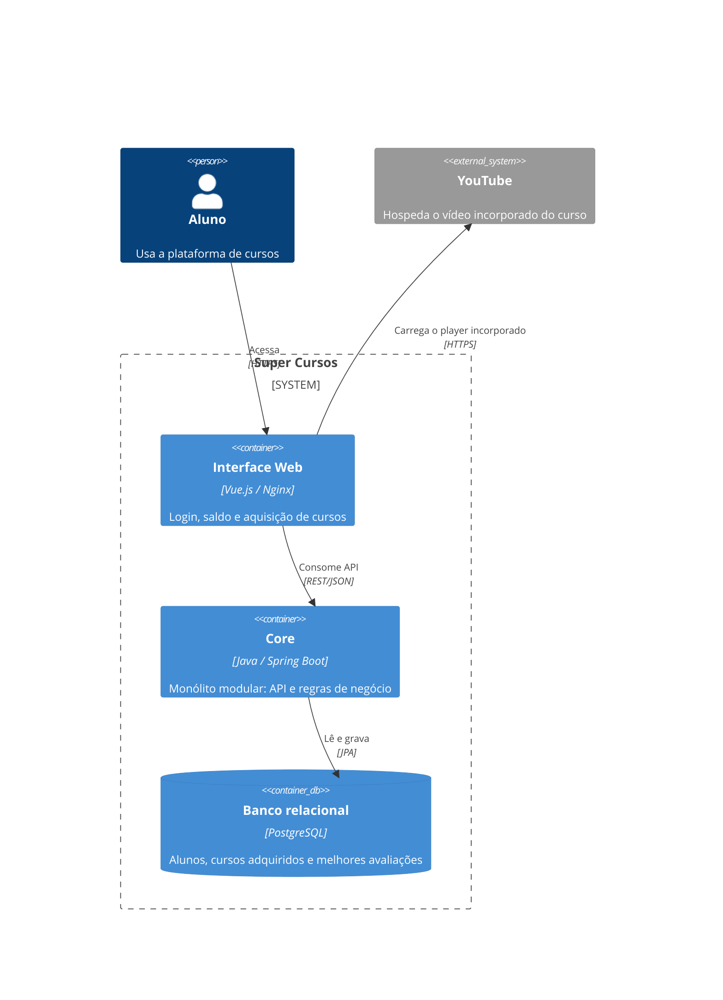
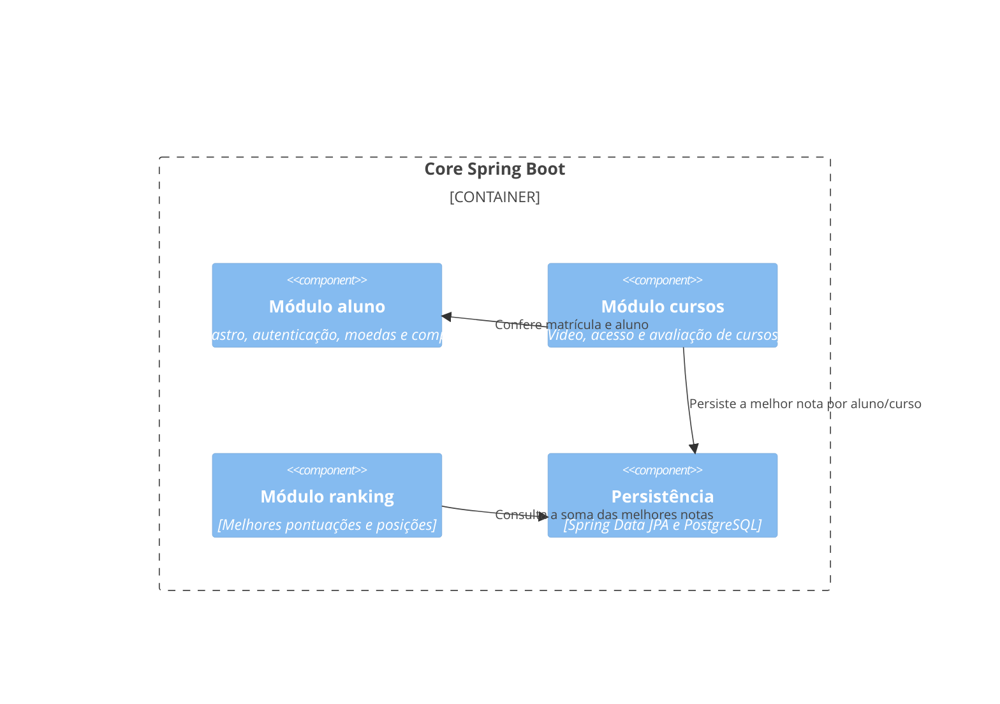

# Registro arquitetural do Super Cursos

Este documento registra a decisão do Desafio 1 do Architecture Lab para o Core
do Super Cursos e sua evidência no código. O Core permanece uma aplicação única
em Java/Spring Boot; a mudança organiza o código por capacidade de negócio como
um monólito modular. Isso responde ao crescimento previsto para até 100.000
usuários sem assumir, sem métricas, que o sistema já precisa de serviços
distribuídos ou de deploy independente.

Este registro cobre o Desafio 1 e a modularização executada no MVP disponível.
Não declara concluídos os demais desafios do B1. A matriz de ASRs abaixo inicia
o registro cumulativo e deverá ser ampliada nos próximos desafios.

## 1. RF e RNF do cenário

| ID | Requisito / atributo | Relação com o projeto atual |
| --- | --- | --- |
| RF01 | Ranking | Implementado como ranking por pontos obtidos nas avaliações dos cursos. |
| RF02 | Conquistas e gamificação | O MVP possui saldo de moedas e aquisição de cursos; badges ainda não fazem parte do escopo implementado. |
| RNF | Manutenibilidade | Capacidades evoluem em ritmos diferentes; fronteiras por negócio reduzem acoplamento e impacto de mudanças. |
| RNF | Escalabilidade | O cenário prevê até 100.000 usuários e crescimento maior para Ranking, mas não apresenta métricas de carga por capacidade. |
| RNF | Complexidade operacional | A equipe registrada no projeto tem três integrantes; operação distribuída aumentaria as responsabilidades de implantação, rede e observabilidade. |
| RNF | Desempenho | Importante, mas não há medições de latência ou throughput que indiquem gargalo arquitetural. |
| RNF | Testabilidade | Importante para validar mudanças; isoladamente, não exige uma decomposição macro. |

### Matriz cumulativa de ASRs

| Desafio | ASR prioritário | Como pode influenciar a arquitetura | Situação |
| --- | --- | --- | --- |
| 1 | Manutenibilidade | Fronteiras por capacidade reduzem dependências e o impacto de mudanças no Core. | Endereçado pela organização do módulo `aluno`. |
| 1 | Escalabilidade | A fronteira de negócio permite observar e, se houver evidência, extrair seletivamente uma capacidade de maior carga. | Ranking e avaliações são módulos separados no Core; ainda não há teste de carga nem métrica que justifique extração. |
| 1 | Complexidade operacional | Manter um único processo e deploy evita introduzir agora operação distribuída sem necessidade comprovada. | Atendido pela decisão de monólito modular. |

Desempenho e testabilidade foram analisados, mas não selecionados como ASRs
macro neste desafio. Testes continuam sendo uma prática de validação da
mudança; não são evidência de que a arquitetura atual tenha um gargalo de
desempenho.

## 2. RPCs e premissas

| RPC | Consequência para a decisão |
| --- | --- |
| Core existente em Java/Spring Boot | A evolução deve aproveitar a aplicação atual e preservar seus contratos. |
| Equipe de três integrantes, conforme o README do projeto | A solução precisa manter custo operacional compatível com a equipe. |
| PostgreSQL e persistência relacional existentes | Não há motivação apresentada para substituir o banco neste desafio. |
| Legado da AC1 | A mudança deve ser incremental e preservar funcionalidades, endpoints, autenticação, tabelas e testes existentes. |
| Crescimento previsto para até 100.000 usuários | É uma premissa de evolução; sem perfil de tráfego, não prova necessidade de distribuição. |

## 3. Alternativas e trade-offs

| Alternativa | Benefícios | Custos e riscos | Avaliação |
| --- | --- | --- | --- |
| A — Monólito em camadas | Deploy e operação simples; continuidade imediata. | As capacidades ficam agrupadas por camada técnica e podem se misturar conforme o produto cresce. | Viável, mas oferece fronteiras de negócio menos explícitas. |
| B — Monólito modular | Organiza código por capacidade, facilita ownership e testes focados, preserva um deploy e permite avaliar extração futura. | Processo, ciclo de implantação e banco continuam compartilhados; fronteiras precisam ser mantidas pela equipe. | Escolhida: melhor equilíbrio entre manutenibilidade e custo operacional para as evidências atuais. |
| C — Serviços independentes | Permite deploy e escala independentes por capacidade. | Acrescenta comunicação de rede, observabilidade distribuída, tratamento de falhas e custo de operação. | Prematura sem medições que exijam escala ou deploy independentes. |

## 4. ADR-001 — Evoluir o Core para monólito modular

**Status:** aceita.

**Contexto:** o produto deve evoluir de MVP para um cenário de até 100.000
usuários. Ranking pode crescer mais que as demais capacidades. O Core possui
alunos, moedas, aquisição de cursos, avaliações e ranking por pontos. Não há
métricas de carga ou evidência de que uma capacidade precise de deploy
independente.

**ASRs e RPCs:** manutenibilidade, escalabilidade futura e controle da
complexidade operacional; Java/Spring Boot, equipe de três integrantes,
PostgreSQL e legado da AC1.

**Alternativas consideradas:** monólito em camadas, monólito modular e
decomposição seletiva em serviços.

**Decisão:** organizar o Core como monólito modular, com módulos de alunos,
cursos e ranking. O Core continua como uma única aplicação Spring Boot e mantém
o banco relacional. O módulo `ranking` já tem uma fronteira própria, mas não
será extraído como serviço sem evidência de gargalo, necessidade de escala
própria ou deploy independente.

**Consequências positivas:** responsabilidades de negócio ficam mais fáceis de
localizar; mudanças e testes podem ser concentrados na capacidade afetada; a
equipe preserva implantação e operação simples; a evolução pode ser incremental.

**Trade-offs:** o módulo não escala nem implanta separadamente; módulos
compartilham processo e banco. A camada de aplicação ainda acessa diretamente o
repositório Spring Data; a inversão dessa dependência pode ser avaliada no
Desafio 2, sem reescrita ampla do produto.

**Gatilho de revisão:** revisar a decisão se medições mostrarem gargalo de
throughput/latência, necessidade sustentada de escala própria ou demanda real
por deploy independente de uma capacidade.

## 5. C4 Container



O C4 mantém o Core como um container/deploy. A modularização afeta sua
organização interna, não a topologia de implantação.

## 6. C4 Component do Core



## 7. Organização interna do Core

```text
com.example.grupo34_atdd/
├── Grupo34AtddApplication.java
├── modules/aluno/
│   ├── api/                         # Controller e DTOs HTTP
│   ├── application/                # Casos de uso e transações
│   ├── domain/                     # Regra de troca de moedas
│   └── infrastructure/persistence/ # Entidade JPA e repositório
├── modules/cursos/
│   ├── api/                         # Catálogo, vídeo e envio de respostas
│   ├── application/                # Catálogo e acesso às avaliações
│   └── domain/                     # Curso e regra de correção
├── modules/ranking/
│   ├── api/                         # Endpoint e contratos do ranking
│   ├── application/                # Ordenação e posições
│   └── infrastructure/persistence/ # Melhores notas por aluno e curso
└── shared/
    ├── config/                     # Segurança transversal
    └── web/                        # Rota inicial
```

O módulo `aluno` mantém autenticação, dados, saldo e aquisição. `cursos` fornece
um catálogo com um vídeo individual por curso e avaliação de dez questões. O
curso inicial é **Introdução ao Python**, com o primeiro vídeo indicado pela
equipe: [Curso Básico de Python — Aula 1](https://www.youtube.com/watch?v=g_R_Asf6Co0).
O player usa somente esse vídeo, sem carregar a playlist. Cada resposta correta
rende 100 pontos, até 1.000 por tentativa. O aluno pode refazer a avaliação e o
recorde do curso é preservado; o ranking soma os recordes dos cursos e empates
compartilham posição. A aquisição continua usando o fluxo de moedas existente e
um curso do catálogo só pode ser acessado pelo aluno que o adquiriu. DTOs HTTP
não dependem de entidades JPA. Segurança transversal e redirecionamento ficam
em `shared`.

### Comparação de dependências

| Antes — por camada | Depois — por capacidade |
| --- | --- |
| `controller` encaminhava a `service`; `service` usava `repository`, `entity`, `domain` e DTOs distribuídos em pacotes irmãos. | `modules/aluno/api` concentra a entrada HTTP; `application`, `domain` e `infrastructure/persistence` ficam no mesmo limite de negócio. Configuração e rota genéricas ficam em `shared`. |
| Para seguir uma mudança de negócio, era preciso navegar entre camadas técnicas espalhadas no pacote raiz. | Os arquivos da funcionalidade e seus testes são encontrados sob o módulo `aluno`; a mudança de pacotes não altera endpoints nem tabelas. |

A mudança deixa as fronteiras de negócio mais explícitas, mas não implementa
inversão completa de dependências: `application` ainda chama diretamente os
repositórios Spring Data e usa alguns DTOs da API. A regra de correção do quiz
permanece sem dependências de Spring ou JPA. Avaliar portas de persistência e
modelos de entrada/saída da aplicação é trabalho possível para o Desafio 2,
caso o custo seja proporcional ao problema observado.

## 8. Evidência e validação

| Evidência | Local / resultado |
| --- | --- |
| Estrutura antes | `src/main/java/com/example/grupo34_atdd/{controller,dto,service,repository,entity,domain,config}` — organização por camada técnica. |
| Estrutura depois | `src/main/java/com/example/grupo34_atdd/modules/{aluno,cursos,ranking}/` e `shared/` — organização por capacidade com responsabilidades internas identificadas. |
| Testes movidos por responsabilidade | `src/test/java/com/example/grupo34_atdd/modules/` contém testes dos módulos `aluno`, `cursos` e `ranking`, além da integração PostgreSQL. |
| Compatibilidade | Mantidos `/api/alunos`, cadastro, listagem, consulta, login e `/{id}/trocar-moedas`; adicionados catálogo, acesso e envio de avaliações, além de `/api/ranking`. Tabelas `alunos` e `aluno_cursos` e custo de 3 moedas mantidos; `resultados_avaliacao` guarda recorde por aluno/curso. |
| Verificação estrutural | Verificados alinhamento de caminhos/pacotes e ausência de referências aos pacotes antigos. |
| Regra de pontuação | Testes cobrem 10 respostas, 100 pontos por acerto, máximo de 1.000, proteção contra redução do recorde e posições empatadas. |
| Testes unitários | `mvn test` no container JDK 21: 33 testes passaram. |
| Testes de integração | `mvn verify` com PostgreSQL 16 via Testcontainers: 9 testes passaram, incluindo pontuação persistida e ranking. |
| Análise estática e pacote | `mvn verify` concluiu com `BUILD SUCCESS`, incluindo PMD e JaCoCo. |
| Build da interface | `docker build` da imagem Vue/Nginx concluiu; build Vite passou. |
| Cypress ponta a ponta | 7 cenários passaram no ambiente Docker isolado, incluindo o fluxo completo de vídeo, avaliação e ranking. |

O mini-lab inclui módulos de cursos e ranking, junto à reorganização do módulo
de alunos. O catálogo começa com um curso demonstrativo; novos cursos exigem
cadastrar título, um vídeo e dez questões com gabarito no `CatalogoCursos`. A
implementação de badges continua fora do escopo desta funcionalidade.

O login e a política de acesso existentes foram preservados. A configuração
atual permite requisições às rotas da API sem sessão autenticada; os novos
endpoints usam o `alunoId` informado na rota e não o vinculam a uma identidade
validada no servidor. Esse comportamento preexistente deve ser revisto antes de
usar a plataforma com dados reais ou expô-la publicamente.

## 9. Rastreabilidade

| Elemento | Registro |
| --- | --- |
| RF | RF01 Ranking por pontos das avaliações; RF02 saldo de moedas e aquisição de cursos. |
| RNF | Manutenibilidade, escalabilidade, complexidade operacional, desempenho e testabilidade analisados. |
| ASR | Manutenibilidade, escalabilidade e complexidade operacional. |
| RPC | Spring Boot, equipe de três integrantes, PostgreSQL e legado da AC1. |
| Alternativas | Monólito em camadas × monólito modular × serviços independentes. |
| ADR | ADR-001: adotar monólito modular; revisar extração por evidência. |
| C4 | Core segue um container; visão Component mostra os módulos de negócio e dependências internas. |
| Evidência | Módulos `cursos` e `ranking`, regras de pontuação, 33 testes unitários, 9 de integração, build Docker do frontend e 7 cenários Cypress aprovados. |

**Conclusão:** a modularização testa a hipótese de que uma capacidade existente
pode ser organizada por negócio sem alterar seu comportamento funcional nem
introduzir comunicação distribuída. O custo operacional continua proporcional à
equipe atual. A necessidade de escala independente do Ranking ainda precisa ser
medida antes de qualquer extração para serviço.

## Próximos desafios do B1

Este README é um registro vivo. Desafios 2 a 6 devem acrescentar seus RFs/RNFs,
até três ASRs prioritários por desafio, RPCs, alternativas, ADR, C4 e evidências,
sem registrar como realizadas microsoluções que ainda não foram implementadas.
