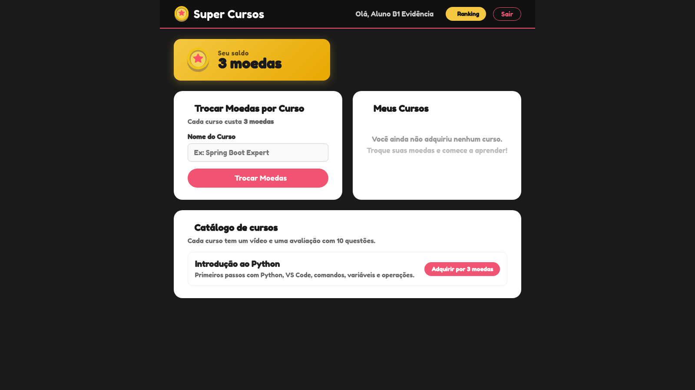

# Desafio 1 — Evolução do Core

O Core foi reorganizado de pastas por camada para módulos por funcionalidade. O diagrama, a decisão e a comparação da estrutura estão no [registro arquitetural B1](../../../docs/arquitetura/README.md). O print abaixo mostra a aplicação após iniciar o ambiente local.

