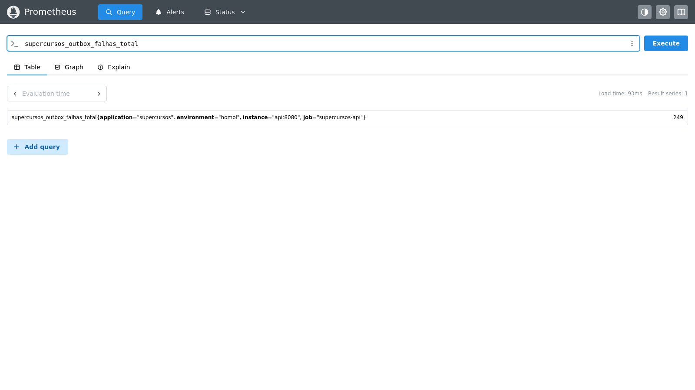

# Desafio 4 — Eventos e processamento eventual

A avaliação grava o resultado e um evento `avaliacao.concluida` na tabela `eventos_outbox`, dentro da mesma transação. Um despachante em segundo plano tenta encaminhar notificações. Se o consumidor falhar, o evento continua pendente, a tentativa aumenta e o fluxo essencial de avaliação permanece concluído. O mini-lab simula a falha em `OutboxDispatcherTest`.

Para esta única integração local, uma tabela Outbox oferece entrega eventual e recuperação após reinício sem adicionar RabbitMQ/Kafka. REST continua síncrono para a resposta que o aluno precisa imediatamente. A notificação é eventual. Mensageria externa deve ser reavaliada se houver mais consumidores, tráfego ou exigência de escala independente.

Métricas: `supercursos_outbox_processados_total` e `supercursos_outbox_falhas_total`. Para simular consumidor indisponível em homologação, inicie a API com `NOTIFICATIONS_ENABLED=false`; a linha fica em `eventos_outbox` com `processado_em` vazio e `tentativas` crescente. Volte a variável para `true` para processar os pendentes.

